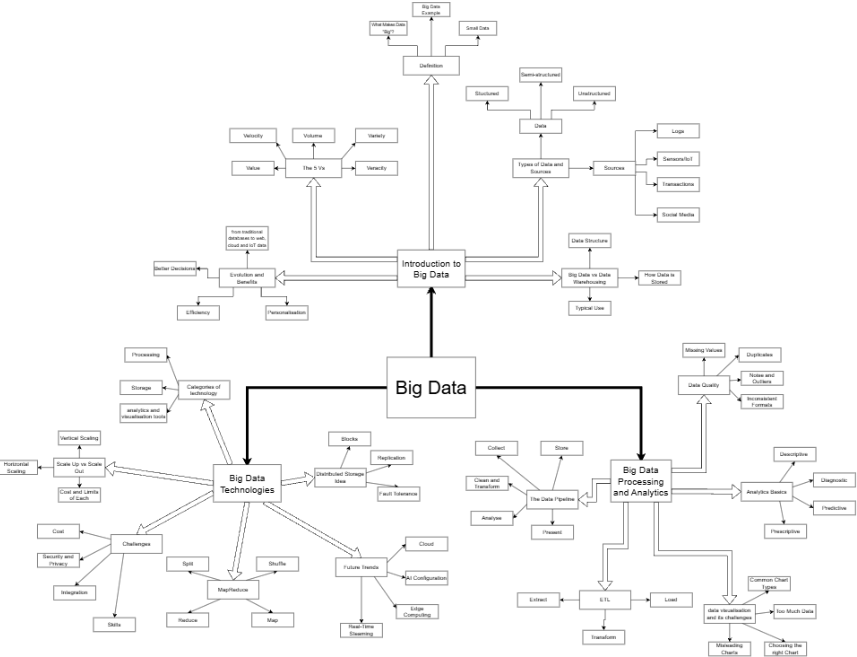
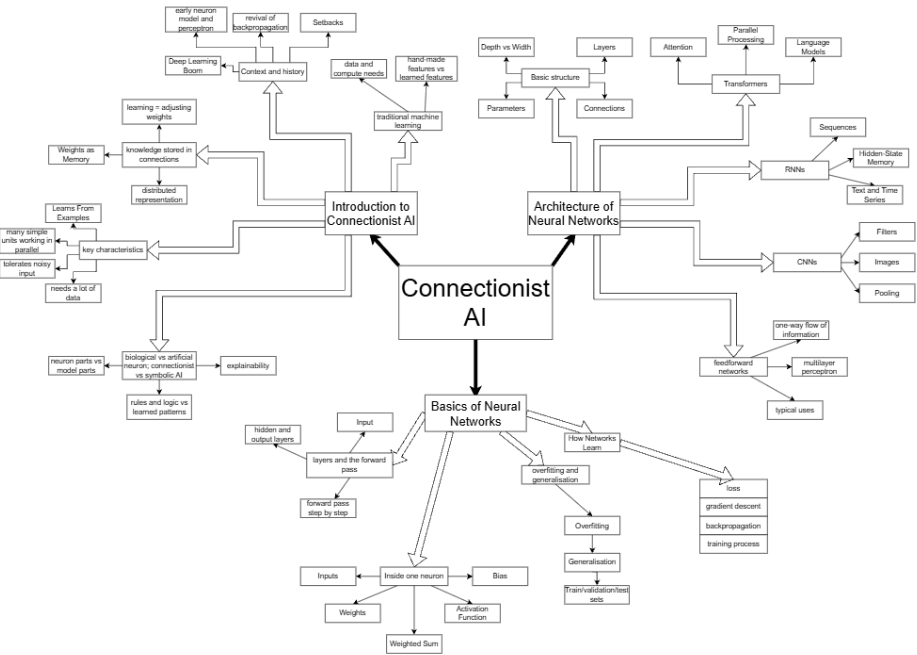
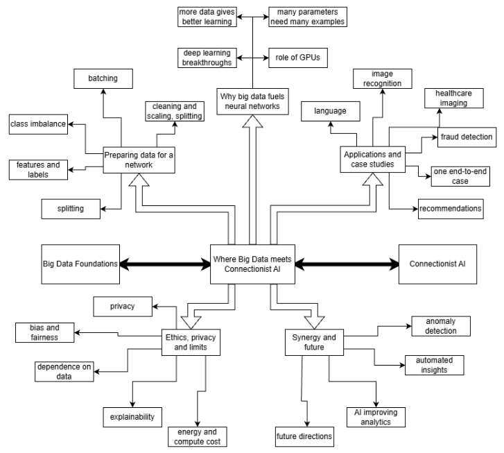

## Stage 3 Guide: Prerequisites, Learning Outcomes & Reading Path

### Module & Team Overview
This Stage 3 guide supports the **Big Data and Connectionist AI** learning module developed by **Team Infihhnite**, designed for beginners with no prior background in data engineering or neural networks. Across 11 chapters organized into three sections, the curriculum builds on the V2.0 baseline and aligns with the module's Study Guide & Test Bank, PPT Slides, and Video Tutorials.

| Name | GitHub Username | Role | Key Responsibilities |
| :--- | :--- | :--- | :--- |
| 林鳳健 | `Kemoosh` | Coordinator (CEO) | Coordinate team meetings, manage timelines and task distribution, oversee project alignment, and maintain project logs |
| 谢文玲 | `melindaox0103` | Repository & Submission Lead (CIO) | Maintain repository structure, organize Markdown files and assets, support content integration, and assemble submission packages |
| 许文龙 | `VoltronZX` | Content & Video Lead | Draft and structure module explanations and worked examples, curate references, and lead interactive video tutorial production |
| 陆秀丽 | `jeeeeeshh` | Visual Design Lead | Create diagrams, illustrations, and visual assets, design PPT slide layouts, and develop the comic-style Study Guide |
| 李大卫 | `CHEEEEZEboi` | Quality Lead | Audit content accuracy, consistency, and completeness; coordinate cross-member reviews and learner walkthrough checks; verify assignment compliance |

---

### Prerequisites
- **No Prior Background Required:** Designed for beginners with no prior experience in data engineering or neural networks.
- **Basic Readiness:** Comfort reading Markdown (`.md`) or PDF documents and following step-by-step worked examples is sufficient to start.

### Learning Outcomes
By completing this module, learners will be able to:
- **Big Data Foundations (Chapters 01–03):** Explain core Big Data concepts, processing and analytics workflows, and foundational technologies.
- **Connectionist AI Mechanics (Chapters 04–06):** Describe Connectionist AI principles and explain how neural network fundamentals and architectures operate.
- **Integration, Ethics & Future Outlook (Chapters 07–11):** Explain how Big Data fuels neural networks, prepare data for a network, examine real-world applications and case studies, evaluate ethical and privacy limits, and identify future trends.

### Recommended Reading Order
Follow the chapters sequentially across the three sections:

1. **Section 1 — Big Data**
   - [Chapter 01: Introduction to Big Data](Stage%202/Task%201:%20Markdown%20Content%20V%202.0/Module%20Chapters/Section%201:%20Big%20Data/Chapter%2001:%20Introduction%20to%20Big%20Data.md)
   - [Chapter 02: Big Data Processing and Analytics](Stage%202/Task%201:%20Markdown%20Content%20V%202.0/Module%20Chapters/Section%201:%20Big%20Data/Chapter%2002:%20Big%20Data%20Processing%20and%20Analytics.md)
   - [Chapter 03: Big Data Technologies](Stage%202/Task%201:%20Markdown%20Content%20V%202.0/Module%20Chapters/Section%201:%20Big%20Data/Chapter%2003:%20Big%20Data%20Technologies.md)
2. **Section 2 — Connectionist AI**
   - [Chapter 04: Introduction to Connectionist AI](Stage%202/Task%201:%20Markdown%20Content%20V%202.0/Module%20Chapters/Section%202:%20Connectionist%20AI/Chapter%2004:%20Introduction%20to%20Connectionist%20AI.md)
   - [Chapter 05: Basics of Neural Networks](Stage%202/Task%201:%20Markdown%20Content%20V%202.0/Module%20Chapters/Section%202:%20Connectionist%20AI/Chapter%2005:%20Basics%20of%20Neural%20Networks.md)
   - [Chapter 06: Architecture of Neural Networks](Stage%202/Task%201:%20Markdown%20Content%20V%202.0/Module%20Chapters/Section%202:%20Connectionist%20AI/Chapter%2006:%20Architecture%20of%20Neural%20Networks.md)
3. **Section 3 — Where Big Data Meets Connectionist AI**
   - [Chapter 07: Why Big Data Fuels Neural Networks](Stage%202/Task%201:%20Markdown%20Content%20V%202.0/Module%20Chapters/Section%203:%20Where%20Big%20Data%20Meets%20Connectionist%20AI/Chapter%2007:%20Why%20Big%20Data%20Fuels%20Neural%20Networks.md)
   - [Chapter 08: Preparing Data for a Network](Stage%202/Task%201:%20Markdown%20Content%20V%202.0/Module%20Chapters/Section%203:%20Where%20Big%20Data%20Meets%20Connectionist%20AI/Chapter%2008:%20Preparing%20Data%20for%20a%20Network.md)
   - [Chapter 09: Applications and Case Studies](Stage%202/Task%201:%20Markdown%20Content%20V%202.0/Module%20Chapters/Section%203:%20Where%20Big%20Data%20Meets%20Connectionist%20AI/Chapter%2009:%20Applications%20and%20Case%20Studies.md)
   - [Chapter 10: Ethics, Privacy, and Limits](Stage%202/Task%201:%20Markdown%20Content%20V%202.0/Module%20Chapters/Section%203:%20Where%20Big%20Data%20Meets%20Connectionist%20AI/Chapter%2010:%20Ethics,%20Privacy,%20and%20Limits.md)
   - [Chapter 11: Synergy and Future](Stage%202/Task%201:%20Markdown%20Content%20V%202.0/Module%20Chapters/Section%203:%20Where%20Big%20Data%20Meets%20Connectionist%20AI/Chapter%2011:%20Synergy%20and%20Future.md)

### Locations of Assets & Learning Resources
- **Visual Assets:** Stored under `assets/` and referenced via relative paths inside the module files. *[Update with exact final Stage 3 subfolder/file paths once confirmed.]*
- **Supporting Learning Resources:**
  - **Study Guide & Test Bank:** Adapts core explanations, worked examples, comic-framed visuals, and practice quizzes with checked answers. *[Insert Stage 3 folder/package path]*
  - **PPT Slides:** Summarizes key concepts, visuals, and interactive checks (including Kahoot! and Quizizz activities). *[Insert Stage 3 folder/package path]*
  - **Video Tutorials:** Covers selected topics with narration and animated/visual demonstrations; refer to the Stage 2 Submission Report resource mapping (and any Stage 3 updates) for topics not covered in video. *[Insert Stage 3 folder/package path]*

### How to Open Supporting Materials
- **Markdown (`.md`) Chapters:** Open directly in the repository viewer, VS Code, or any Markdown editor; keep relative links and folder paths intact so chapter navigation and visual assets resolve properly.
- **PDF & Submission Package:** Extract the Stage 3 submission archive (or reference `Infihhnite_Stage2_Markdown_V2.zip` for the V2.0 baseline) and open the rendered PDF and report files in any standard PDF or document viewer.

### Final Version Information & Known Limitations
- **Version:** Stage 3 release built on the **V2.0** baseline (`Infihhnite_Stage2_Markdown_V2.zip`). *[Insert final Stage 3 version tag, release date, and commit ID.]*
- **Known Limitations:**
  - **Video Coverage:** Video tutorials cover selected topics rather than every chapter; check the Stage 2 Submission Report resource mapping (and Stage 3 notes) for excluded topics.
  - **Introductory Depth:** Concepts, worked examples, and technical details are presented at an accessible, beginner-friendly level rather than an exhaustive engineering deep dive.
  - **Pending Stage 3 Confirmations:** *[Update any final Stage 3 file paths, release metadata, or remaining polish items before submission.]*
## Module & Section Roadmaps

- **Section 1 — Big Data (Chapters 01–03):**
  

- **Section 2 — Connectionist AI (Chapters 04–06):**
  

- **Section 3 — Where Big Data Meets Connectionist AI (Chapters 07–11):**
  
