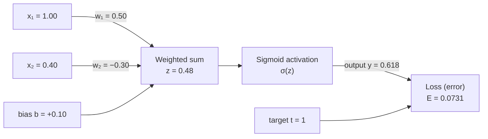

## Chapter 6: Architecture of Neural Networks

> **Part:** Connectionist AI · **Chapter:** Architecture of Neural Networks · **Level:** Beginner
> **Before you start:** this chapter builds on 5.2 Inside One Neuron and 5.4 Layers and the Forward Pass.

---

### 6.1 Basic structure

**Terms addressed:** Layers, Connections, Parameters (also Depth and Width).

#### Explanations

A neural network is built from **neurons** arranged in **layers**, joined by **connections**. Each connection carries a number (a **weight**), and each neuron has one extra number (a **bias**). These weights and biases are the network's **parameters**, and training adjusts them.

- **Layers:** the **input layer** holds the data, **hidden layers** transform it, and the **output layer** gives the answer.
- **Connections:** each arrow from one neuron to the next. Every connection has its own weight.
- **Parameters:** all the weights and biases. The bias belongs to the **neuron**, not to a connection.

The simplest possible network is **one neuron**: an input layer feeding a single output neuron. The diagram below shows one neuron working on a real example, and the **loss** that measures how wrong the output is.



**Reading the diagram**

- The **weighted sum** and the **activation** are the two steps *inside one neuron*. They are not separate layers.
- The **loss** is *not* part of the network. It is calculated afterwards by comparing the output with the correct answer (the **target**).

#### Terminology

| Term | Meaning |
|---|---|
| **Layer** | A group of neurons that work side by side |
| **Connection** | A link that carries one neuron's output to another neuron, scaled by a weight |
| **Parameter** | A weight or bias that is learned during training |
| **Depth** | The number of **hidden layers** (some books count all layers, so always state which) |
| **Width** | The number of neurons in one layer |
| **Loss (error)** | A number that says how far the output is from the target |

**Depth and width.** *Depth* is how many hidden layers are stacked. A **deep** network has many. *Width* is how many neurons a layer has. A wider layer can learn more patterns at one level. A deeper network can combine simple patterns into more complex ones.

#### Worked example: the single neuron

| Step | Calculation | Result |
|---|---|---|
| 1. Weigh | 1.00 × 0.50 and 0.40 × (−0.30) | 0.50 and −0.12 |
| 2. Sum plus bias | 0.50 − 0.12 + 0.10 | **z = 0.48** |
| 3. Sigmoid | 1 / (1 + e⁻⁰·⁴⁸) | **y ≈ 0.618** |
| 4. Loss | With target t = 1 and E = ½ (t − y)²: ½ × (1 − 0.618)² | **E ≈ 0.0731** |

**Parameters in this neuron:** 2 weights + 1 bias = **3**.

#### Learner activity

**Task 1.** A network has 2 inputs, one hidden layer of 3 neurons, and 1 output neuron. State its depth and the width of the hidden layer, then count its parameters.

**Task 2.** In the worked example, is the **loss** part of the network? Explain.

#### Answers and expected outcomes

<details>
<summary><b>Click to reveal</b></summary>

**Task 1**
- Depth = **1** hidden layer. Width of the hidden layer = **3**.
- Hidden layer: 3 neurons × 2 weights = 6 weights + 3 biases = 9.
- Output layer: 1 neuron × 3 weights = 3 weights + 1 bias = 4.
- Total = **13 parameters**.

**Task 2**
- No. The loss is calculated *outside* the network by comparing the output (0.618) with the target (1). The network ends at the output.

**Expected outcome:** the learner can name layers, connections and parameters, count parameters, and separate the network from the loss.

**Teacher check:** ask, "Where does the bias belong: on a connection or on a neuron?" A good answer: on the neuron.

</details>

#### References

1. 3Blue1Brown. (2017). *But what is a neural network? | Chapter 1, Deep learning* [Video]. YouTube. https://www.youtube.com/watch?v=aircAruvnKk
2. Nielsen, M. A. (2015). *Neural Networks and Deep Learning*, Chapter 1. Determination Press. http://neuralnetworksanddeeplearning.com/
3. Goodfellow, I., Bengio, Y., & Courville, A. (2016). *Deep Learning*, Chapter 6. MIT Press. https://www.deeplearningbook.org/
4. Stanford CS231n. *Neural Networks Part 1: Setting up the Architecture.* https://cs231n.github.io/neural-networks-1/

---

### 6.2 Transformers

**Terms addressed:** Attention, Language Models, Parallel Processing.

#### Explanations

A **Transformer** is a network design built around **attention**. It was introduced in 2017 [1] and is the design behind most modern large language models.

- **Attention:** for each item in a sequence (for example each word), the network works out **how relevant every other item is**, and uses those relevance scores to mix information. This lets a word be understood in the context of the whole sentence, however far apart the related words are.
- **Language model:** a model that predicts the next word (or piece of a word, called a *token*) from the words before it. A **large language model** is a very large language model, and most are built from Transformers.
- **Parallel processing:** a Transformer can process all positions in a sequence **at the same time** during training. An RNN (see 6.3) must go one step at a time. This makes Transformers much better suited to modern parallel hardware, and in the original paper they trained in significantly less time than earlier designs while giving better translation quality [1].

**Trade-off:** attention compares every position with every other, so the cost grows quickly as the sequence gets longer.

#### Terminology

| Term | Meaning |
|---|---|
| **Attention** | A way of scoring how relevant each part of a sequence is to another part |
| **Token** | A word or piece of a word treated as one unit |
| **Language model** | A model that predicts the next token from the tokens before it |
| **Parallel processing** | Doing many calculations at the same time |

#### Check yourself

1. In one sentence, what does attention do?
2. Why can a Transformer train faster than an RNN on the same hardware?

<details>
<summary><b>Click to reveal</b></summary>

1. It lets each token weigh how relevant every other token is, so each token is understood in context.
2. It processes all positions at once, while an RNN must process them one after another.

</details>

#### References

1. Vaswani, A., et al. (2017). *Attention Is All You Need.* NeurIPS. https://arxiv.org/abs/1706.03762
2. Alammar, J. (2018). *The Illustrated Transformer.* https://jalammar.github.io/illustrated-transformer/
3. 3Blue1Brown. (2024). *Transformers, the tech behind LLMs | Deep Learning Chapter 5* and *Attention in transformers, step-by-step | Deep Learning Chapter 6* [Videos]. YouTube.
4. Jurafsky, D., & Martin, J. H. *Speech and Language Processing* (3rd ed. draft), chapters on language models and Transformers. https://web.stanford.edu/~jurafsky/slp3/

---

### 6.3 RNNs

**RNNs (Recurrent Neural Networks)**
**Terms addressed:** Sequences, Hidden-state memory, Text and time series.

#### Explanations

An **RNN** is designed for **sequences**, where order matters, such as the words in a sentence or daily temperature readings.

An RNN reads a sequence **one step at a time**. At each step it applies the **same weights** to two things: the current input and the **hidden state** carried over from the previous step. This gives the network a form of **memory**.

```text
h(t) = f( Wx · x(t) + Wh · h(t−1) + b )
```

- `x(t)` is the input at step t.
- `h(t−1)` is the memory from the previous step.
- `h(t)` is the new memory, passed on to the next step.

This **recurrent** loop is what separates an RNN from a feedforward network, where data never flows back.

**Typical uses:** text (reading a sentence), speech, and time series such as weather or energy demand.

**Limits:** basic RNNs struggle to remember things from far back, because the learning signal fades over many steps (the *vanishing gradient* problem). **LSTM** and **GRU** designs were created to reduce this. For language tasks, Transformers (6.2) have largely replaced RNNs, but RNNs remain a useful way to learn the idea of memory in a network.

#### Terminology

| Term | Meaning |
|---|---|
| **Sequence** | Data where order matters |
| **Hidden state** | The memory an RNN carries from one step to the next |
| **Recurrent** | Feeding an output back in as part of the next input |
| **Time series** | Measurements recorded over time |

#### Check yourself

1. What two things does an RNN combine at each step?
2. Why is an RNN slower to train than a Transformer?

<details>
<summary><b>Click to reveal</b></summary>

1. The current input and the hidden state from the previous step.
2. It must process the sequence one step at a time, so the steps cannot run in parallel.

</details>

#### References

1. Olah, C. (2015). *Understanding LSTM Networks.* https://colah.github.io/posts/2015-08-Understanding-LSTMs/
2. Goodfellow, I., Bengio, Y., & Courville, A. (2016). *Deep Learning*, Chapter 10: Sequence Modeling: Recurrent and Recursive Nets. MIT Press. https://www.deeplearningbook.org/
3. DeepLearning.AI & Coursera. (n.d.). *Sequence Models* (Course 5 of Deep Learning Specialization by Andrew Ng). https://www.coursera.org/specializations/deep-learning

---

### 6.4 CNNs

**CNNs (Convolutional Neural Networks)**
**Terms addressed:** Filters, Images, Pooling.

#### Explanations

A **Convolutional Neural Network (CNN)** is designed for **images** and other grid-like data.

- **Filters (kernels):** a filter is a small grid of **learnable weights** (for example 3 × 3). It slides across the image, and at each position it computes a weighted sum of the small patch beneath it. Early filters tend to learn simple features such as edges. Later layers combine them into shapes and objects.
- **Weight sharing:** the **same filter** is reused across the whole image, and each output depends only on a small local patch. A CNN therefore needs far fewer parameters than a network where every input connects to every neuron.
- **Pooling:** a step that shrinks the output, for example by keeping only the largest value in each small block (**max pooling**). It reduces computation and makes the result less sensitive to small shifts in the image.

#### Terminology

| Term | Meaning |
|---|---|
| **Filter (kernel)** | A small grid of learnable weights that detects one kind of feature |
| **Feature map** | The output produced when one filter slides over the image |
| **Pooling** | Shrinking a feature map by summarizing small blocks |

#### Check yourself

1. Are the numbers inside a filter fixed by the designer or learned in training?
2. Name two benefits of pooling.

<details>
<summary><b>Click to reveal</b></summary>

1. Learned in training.
2. Less computation, and less sensitivity to small shifts in the image.

</details>

#### References

1. Stanford CS231n. *Convolutional Neural Networks for Visual Recognition.* https://cs231n.github.io/convolutional-networks/
2. Goodfellow, I., Bengio, Y., & Courville, A. (2016). *Deep Learning*, Chapter 9: Convolutional Networks. MIT Press. https://www.deeplearningbook.org/
3. DeepLearning.AI & Coursera. (n.d.). *Convolutional Neural Networks* (Course 4 of Deep Learning Specialization by Andrew Ng). https://www.coursera.org/specializations/deep-learning

---

### 6.5 Feedforward Networks

**Terms addressed:** Feedforward networks, One-way flow, Multilayer perceptron, Typical uses.

#### Explanations

In a **feedforward network**, information moves in **one direction only**: from the input layer, through any hidden layers, to the output layer. Nothing loops back.

A **Multilayer Perceptron (MLP)** is the basic kind of feedforward network. Every neuron in one layer connects to **every** neuron in the next (a *fully connected* network). The network in 6.1 and the one in 5.4 are both MLPs.

Not every feedforward network is an MLP. A **CNN** (6.4) is also feedforward, but its connections are local and shared rather than fully connected. An **RNN** (6.3) is *not* feedforward because it has a loop.

**Typical uses:** prediction and classification on **tabular (structured) data**, for example forecasting a house price from its features, or sorting customers into groups.

#### Architecture at a glance

| Architecture | Data flow | Best for | Key idea |
|---|---|---|---|
| **Feedforward / MLP** | One way, fully connected | Tabular data | Layers of weighted sums |
| **CNN** | One way, local connections | Images | Shared filters and pooling |
| **RNN** | Loops through a hidden state | Sequences | Memory from step to step |
| **Transformer** | All positions at once | Language and long sequences | Attention |

#### Terminology

| Term | Meaning |
|---|---|
| **Feedforward network** | A network where data flows only from input to output |
| **MLP** | A fully connected feedforward network |
| **Fully connected layer** | A layer where every neuron connects to every neuron in the previous layer |

#### Check yourself

1. Is a CNN a feedforward network? Is an MLP a CNN?
2. Which of the four architectures in the table would you try first for a spreadsheet of house prices?

<details>
<summary><b>Click to reveal</b></summary>

1. A CNN is feedforward. An MLP is not a CNN, because its layers are fully connected.
2. A feedforward network (MLP), because the data is tabular.

</details>

#### References

1. 3Blue1Brown. (2017). *But what is a neural network? | Chapter 1, Deep learning* [Video]. YouTube. https://www.youtube.com/watch?v=aircAruvnKk
2. Nielsen, M. A. (2015). *Neural Networks and Deep Learning*, Chapter 1. Determination Press. http://neuralnetworksanddeeplearning.com/
3. Goodfellow, I., Bengio, Y., & Courville, A. (2016). *Deep Learning*, Chapter 6: Deep Feedforward Networks. MIT Press. https://www.deeplearningbook.org/
