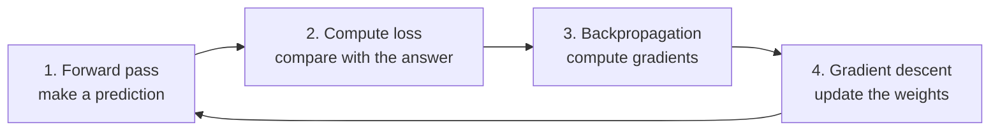
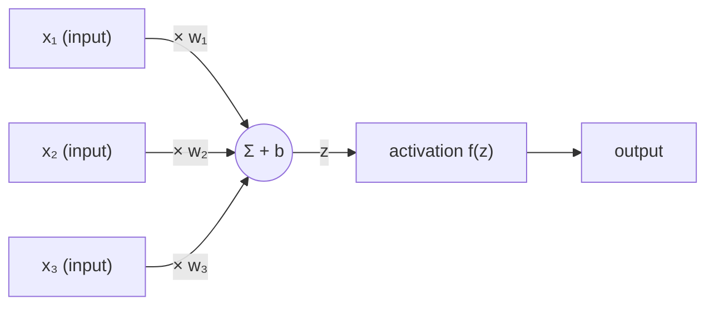
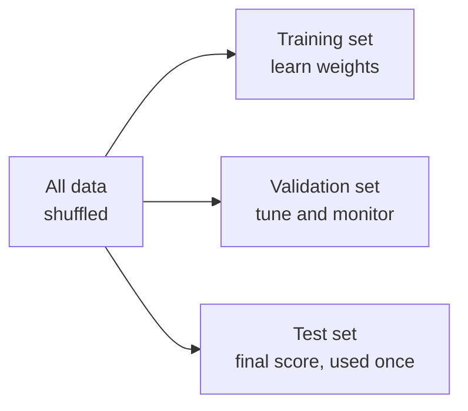
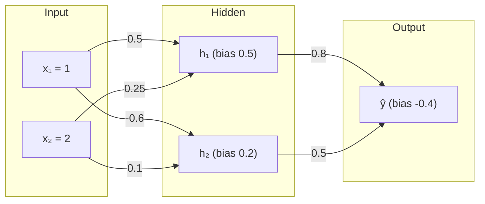

## Chapter 5: Basics of Neural Networks

### 5.1 How Networks Learn

> **Part:** Connectionist AI · **Chapter:** Basics of Neural Networks · **Level:** Beginner
> **Covers:** loss, gradient descent, backpropagation, the training process
> **Before you start:** this lesson uses *weights* and *predictions* (see 2.2 Inside One Neuron) and the *forward pass* (see 5.4 Layers and the Forward Pass). If you have not read them yet, read them first.

---

#### Explanations

A neural network learns by **adjusting its weights** (the numbers inside it that control its behavior) until its predictions get close to the correct answers. Learning is a loop of three jobs:

| Job | Question it answers | Tool |
|---|---|---|
| **Measure the error** | How wrong is the network right now? | Loss function |
| **Find the blame** | How much did each weight contribute to the error? | Backpropagation |
| **Fix the weights** | Which way, and how far, should each weight move? | Gradient descent |

##### Gradient descent and loss
The **loss** is a single number saying how wrong the network is. Lower is better. Training means finding weights that make the loss as small as possible.

Picture the loss as a hilly landscape and the weight as a ball. The **gradient** is the slope under the ball. It points uphill, so we step in the **opposite** direction (downhill):

```text
new weight = old weight − learning rate × gradient
```

##### Backpropagation
A real network has millions of weights, so we need each weight's gradient quickly. **Backpropagation** does this with the **chain rule** (a calculus rule for combining small effects into one big effect). It starts at the loss, works backward layer by layer, and reuses earlier results.

> ⚠️ **Common mix-up:** backpropagation only *computes* the gradients. Gradient descent *uses* them to update the weights. They are two separate steps.

##### The training process
Each training step repeats four moves, shown here as a loop:



The loop runs over the training data many times. Data is usually fed in small groups called **mini-batches**, and one full pass over all the data is an **epoch**. When the update uses a small batch rather than all the data, the method is called **mini-batch** (or *stochastic*) gradient descent.

##### Good to know

1. **Different tasks use different loss functions.** *Mean squared error* (MSE) is common when predicting numbers, like a house price. *Cross-entropy* is common when choosing a category, like cat or dog.
2. **Real networks have many weights.** Each weight gets its **own gradient** and is updated by the same rule. The worked example uses one weight only to keep the numbers readable.
3. **Backpropagation needs the forward pass.** The values calculated on the way forward are stored, then reused on the way back. That is why the forward pass always comes first.
4. **Watch the loss to diagnose training.** If loss falls steadily, learning is working. If it bounces up and down or grows, the learning rate is usually too high. If it barely moves, it may be too low. Training usually stops when the loss on **validation** data stops improving (see 5.3). Falling loss on training data alone does not prove the network is good, which is the topic of 5.3 *Overfitting and Generalization*.

---

#### Terminology

| Term | Meaning |
|---|---|
| **Weight / parameter** | A number inside the network that is adjusted during learning |
| **Loss function** | A formula that turns the network's error into one number |
| **Gradient** | The slope of the loss for a weight: which way and how steeply the loss rises |
| **Learning rate** | The step size of each update. Too small is slow. Too large overshoots |
| **Chain rule** | Calculus rule that multiplies small effects together to get a total effect |
| **Mini-batch** | A small group of training examples used for one update (often just called a *batch*) |
| **Epoch** | One full pass through the whole training set |

---

#### Worked example: one weight learning

**Setup:** the network is just `prediction = w × x`. The input is `x = 2` and the correct answer is `4`, so the ideal weight is `w = 2`. Loss = `(prediction − 4)²`. Learning rate = `0.05`. Start at `w = 0`.

**Backpropagation on this tiny network** (chain rule):

```text
dLoss/dw = dLoss/dprediction × dprediction/dw
         = 2 × (prediction − 4)  ×  x
```

**Training steps:**

| Step | w | Prediction (w×2) | Loss | Gradient = 2(pred − 4)×2 | New w = w − 0.05 × gradient |
|---|---|---|---|---|---|
| 0 | 0 | 0 | 16 | −16 | 0 + 0.8 = **0.8** |
| 1 | 0.8 | 1.6 | 5.76 | −9.6 | 0.8 + 0.48 = **1.28** |
| 2 | 1.28 | 2.56 | 2.07 | −5.76 | 1.28 + 0.288 = **1.568** |

**What to notice:** the loss falls each step (16 → 5.76 → 2.07) and `w` moves toward 2. Steps get smaller because the slope gets flatter near the bottom.

**Check:** the distance from the ideal weight (2) shrinks by the same factor each step: 2 → 1.2 → 0.72 → 0.432. That factor is 0.6, which comes from `1 − 0.05 × 8`. This is why the steps get smaller and smoother.

---

#### Learner activity

**Task 1.** Using the same setup, calculate **Step 3** starting from `w = 1.568`. Fill in the prediction, loss, gradient and new `w`.

**Task 2.** Redo **Step 0** with a larger learning rate of `0.3`. What is the new `w`, the new prediction, and the new loss? Compare the new loss with the starting loss of 16 and explain what happened.

**Task 3.** For this network, the update is `new w = w − learning rate × 8 × (w − 2)`. Show that with a learning rate of **0.25** the weight just bounces between two values, and explain what happens for a learning rate **above 0.25**.

---

#### Answers and expected outcomes

<details>
<summary><b>Click to reveal</b></summary>

**Task 1**

| Prediction | Loss | Gradient | New w |
|---|---|---|---|
| 1.568 × 2 = **3.136** | (3.136 − 4)² ≈ **0.7465** | 2 × (−0.864) × 2 = **−3.456** | 1.568 + 0.05 × 3.456 = **1.7408** |

**Task 2**
- Gradient at Step 0 is still −16, so new `w = 0 − 0.3 × (−16) = 4.8`.
- New prediction = 4.8 × 2 = **9.6**, new loss = (9.6 − 4)² = **31.36**.
- The loss went **up** from 16 to 31.36. The step was too big, so `w` jumped past the ideal value of 2 and landed on the other side of the valley. This is **overshooting**.

**Task 3**
- The distance from 2 is multiplied by `1 − 8 × lr` every step. With `lr = 0.25` the factor is `1 − 2 = −1`, so `w` flips from one side of 2 to the other with the **same distance**. It never settles (for example 0 → 4 → 0).
- Above 0.25 the factor is below −1, so the distance **grows** each step and the loss increases. This is **divergence**. (At 0.3 the factor is −1.4: 0 → 4.8 → −1.92 → …)
- **Takeaway:** the best learning rate depends on the problem. Too large and training diverges.

**Expected outcome:** the learner can apply the update rule by hand and explain that the learning rate controls step size, with too large a value causing overshooting.

**Teacher check:** ask, "What is the difference between backpropagation and gradient descent?" A good answer: backpropagation computes each weight's gradient, and gradient descent uses the gradients to update the weights.

</details>

---

#### References

1. Cornell Virtual Workshop. *Gradient Descent.* https://cvw.cac.cornell.edu/SciML/mlp/gradient-descent
2. Cornell University, CS 4780. *The Backpropagation Algorithm* (lecture notes). https://www.cs.cornell.edu/courses/cs4780/2023fa/lectures/note_backprop.pdf
3. Nielsen, M. A. (2015). *Neural Networks and Deep Learning*, Chapter 2: How the backpropagation algorithm works. Determination Press. http://neuralnetworksanddeeplearning.com/
4. Rumelhart, D. E., Hinton, G. E., & Williams, R. J. (1986). Learning representations by back-propagating errors. *Nature*, 323, 533–536.
5. 3Blue1Brown. (2017). *Gradient descent, how neural networks learn | Deep Learning Chapter 2* and *Backpropagation, intuitively | Deep Learning Chapter 3* [Videos]. YouTube.

---

### 5.2 Inside One Neuron

> **Part:** Connectionist AI · **Chapter:** Basics of Neural Networks · **Level:** Beginner
> **Covers:** inputs, bias and weights · weighted sum · activation function

---

#### Explanations

An **artificial neuron** is the basic building block of a neural network. It takes in several numbers, does a small calculation, and produces **one** output number. That output can become an input for other neurons.

Every neuron does the same three things, in order:

1. **Weigh** each input by multiplying it by its weight.
2. **Sum** the weighted inputs and add the bias. This gives one number, `z`.
3. **Activate**: pass `z` through an activation function to get the output.

```text
output = f( w₁x₁ + w₂x₂ + … + wₙxₙ + b )
```

##### Inputs, weights and bias
- **Inputs (x):** the numbers going in. They are either the raw data or the outputs of the previous layer.
- **Weights (w):** one per input. A weight says how **important** its input is. A large positive weight pushes the neuron up, a negative weight pushes it down, and a weight near zero means the input is mostly ignored.
- **Bias (b):** one extra number per neuron, added to the sum. It shifts how easily the neuron switches on, even when every input is zero.

Weights and biases are the **learnable parameters**. Training (see 5.1) adjusts them.

##### Weighted sum
Multiply each input by its weight, add the results, then add the bias. The result `z` is called the **pre-activation value**.

##### Activation function
The **activation function** `f` turns `z` into the neuron's final output. It matters because without it, stacking layers would collapse into one simple linear calculation, which cannot learn complex patterns. The activation function adds **non-linearity**.

| Function | Rule | Output range | Behavior |
|---|---|---|---|
| **Step** | 1 if `z > 0`, otherwise 0 | 0 or 1 | On/off switch |
| **Sigmoid** | `1 / (1 + e⁻ᶻ)` | between 0 and 1 | Smooth S-curve, squashes any `z` |
| **ReLU** | `max(0, z)` | 0 and above | Blocks negatives, passes positives |

##### Visual: one neuron



> The design is loosely inspired by a biological neuron (inputs ≈ dendrites, weights ≈ connection strength, output ≈ axon), but an artificial neuron is only a simple math formula.

---

#### Terminology

| Term | Meaning |
|---|---|
| **Neuron (node)** | A unit that takes inputs and produces one output |
| **Input (x)** | A number fed into the neuron |
| **Weight (w)** | A learnable number that scales its input's importance |
| **Bias (b)** | A learnable number added to the sum, shifting when the neuron activates |
| **Weighted sum (z)** | Σ(w × x) + b, the value before activation |
| **Activation function (f)** | Turns `z` into the neuron's output and adds non-linearity |
| **Non-linearity** | Behavior that is not a straight-line relationship, needed to learn complex patterns |

---

#### Worked example: "Should I go out to play?"

One neuron decides whether to go outside. Inputs are `1` for yes and `0` for no.

| Input | Meaning | Value (x) | Weight (w) |
|---|---|---|---|
| x₁ | It is sunny | 1 | **0.6** |
| x₂ | Friends are going | 1 | **0.5** |
| x₃ | Homework is still not done | 1 | **−0.8** |

Bias `b = −0.2` (a small built-in reluctance to go out).

| Step | Calculation | Result |
|---|---|---|
| 1. Weigh | 0.6×1, 0.5×1, −0.8×1 | 0.6, 0.5, −0.8 |
| 2. Sum | 0.6 + 0.5 + (−0.8) | 0.3 |
| 3. Add bias | 0.3 + (−0.2) | **z = 0.1** |
| 4a. Activate (ReLU) | max(0, 0.1) | **0.1** |
| 4b. Activate (Sigmoid) | 1 / (1 + e⁻⁰·¹) | **≈ 0.525** |

**What to notice:** the negative weight on homework pulled the total down from 1.1 to 0.3. Sigmoid shows the neuron is only slightly leaning toward "go" (a little above 0.5). The same `z` gives different outputs under different activation functions.

---

#### Learner activity

Use the same weights (`0.6`, `0.5`, `−0.8`) and bias (`−0.2`).

**Task 1.** It is **rainy** (x₁ = 0), **friends are going** (x₂ = 1), and **homework is done** (x₃ = 0). Find `z`, the ReLU output, and the sigmoid output. Use a calculator for difficult calculations.

**Task 2.** Now **every input is 0**. What is `z`, and what does this show about the role of the bias?

---

#### Answers and expected outcomes

<details>
<summary><b>Click to reveal</b></summary>

**Task 1**

| Weighted terms | Sum | z (after bias) | ReLU | Sigmoid |
|---|---|---|---|---|
| 0, 0.5, 0 | 0.5 | 0.5 − 0.2 = **0.3** | **0.3** | 1 / (1 + e⁻⁰·³) ≈ **0.574** |

**Task 2**
- All weighted terms are 0, so `z = 0 + (−0.2) = −0.2`.
- ReLU gives max(0, −0.2) = **0**, so the neuron is off.
- The bias works even when all inputs are zero. It sets the neuron's **starting tendency**, here a slight lean toward "no".

**Expected outcome:** the learner can compute a neuron's output in three steps (weigh, sum plus bias, activate) and explain that weights set the importance of inputs while bias shifts the starting point.

**Teacher check:** ask, "If we removed the activation function from every neuron, why would a many-layer network be no more powerful than one neuron?" A good answer: each layer would only do weighted sums, and stacked weighted sums collapse into a single weighted sum, so no complex patterns could be learned.

</details>

---

#### References

1. Runestone Academy, *AI4All*. "Inputs, Weights, and Biases." https://runestone.academy/ns/books/published/ai4all/sec-inputs-weights-and-biases.html
2. Nielsen, M. A. (2015). *Neural Networks and Deep Learning*, Chapter 1: Using neural nets to recognize handwritten digits (perceptrons and sigmoid neurons). Determination Press. http://neuralnetworksanddeeplearning.com/
3. Stanford CS231n. *Neural Networks Part 1: Setting up the Architecture* (biological motivation and activation functions). https://cs231n.github.io/neural-networks-1/
4. Goodfellow, I., Bengio, Y., & Courville, A. (2016). *Deep Learning*, Chapter 6: Deep Feedforward Networks. MIT Press. https://www.deeplearningbook.org/

---

### 5.3 Overfitting and Generalization

> **Part:** Connectionist AI · **Chapter:** Basics of Neural Networks · **Level:** Beginner
> **Covers:** overfitting, underfitting, train/validation/test sets, early stopping

---

#### Explanations

The goal of training is **not** to do well on the examples the network has already seen. The goal is to do well on **new** examples it has never seen. This ability is called **generalization**.

##### Overfitting
**Overfitting** happens when a network learns the training data too closely, including its random noise and quirks, instead of the real underlying pattern. It scores very well on training data but badly on new data. It is like a student who memorizes last year's exam answers: perfect on those exact questions, lost on new ones.

The opposite problem is **underfitting**: the network has not learned enough, so it performs poorly on *both* training and new data.

| | Training performance | New-data performance | Diagnosis |
|---|---|---|---|
| ✅ Good fit | Good | Good | Generalizes well |
| ⚠️ Overfitting | Very good | Poor | Memorized the training set |
| ❌ Underfitting | Poor | Poor | Has not learned enough |

##### Train, validation and test sets
To *detect* overfitting we must test on data the network did not train on. So the data is shuffled and split into three separate sets:

| Set | Role | Used |
|---|---|---|
| **Training set** | The network learns its weights from it | Over and over during training |
| **Validation set** | Monitor progress and tune settings (like the learning rate) while building | Repeatedly during development |
| **Test set** | One final, unbiased score of real-world performance | Once, at the very end |

Common split ratios are 60/20/20, 70/15/15 and 80/10/10, and there is no single best ratio.

**Note:** shuffling before splitting suits independent examples such as photos. For **time series** data (for example daily sales), keep the time order. Train on the earlier data, and validate and test on the later data.



> ⚠️ **Common mix-up:** do not keep checking the test set while building. Once you tune the model to it, it is no longer "unseen" and its score becomes over-optimistic.

##### How to spot overfitting
Watch the **training loss** and **validation loss** together:

- Both falling: the network is learning and generalizing.
- Training loss falling but **validation loss rising**: **overfitting**.

A simple fix is **early stopping**: stop training when the validation loss stops improving. In practice, training often continues a few more epochs after the best result (this wait is called *patience*), then the weights from the best epoch are restored.

##### Other ways to reduce overfitting

| Method | Idea |
|---|---|
| **More training data** | A larger, more varied set is harder to memorize. |
| **Simpler model** | Fewer layers or neurons leave less room to memorize. |
| **Regularization** | Add a penalty for large weights so the network stays simpler. |
| **Dropout** | Randomly switch off some neurons during training so no neuron is relied on too much. |
| **Data augmentation** | Create varied copies of training examples (for images: flips, crops, small rotations). |

---

#### Terminology

| Term | Meaning |
|---|---|
| **Generalization** | Performing well on new data the network has never seen |
| **Overfitting** | Memorizing training data (and its noise) so that new-data performance is poor |
| **Underfitting** | Not learning enough, so performance is poor on all data |
| **Noise** | Random quirks or errors in data that carry no real pattern |
| **Training / validation / test set** | Three separate portions of the data, used for learning, tuning and final scoring |
| **Early stopping** | Ending training when validation loss stops improving |
| **Data leakage** | Test information accidentally influencing training or tuning, making scores unrealistically good |

---

#### Worked example: spotting the stop point

1,000 photos of cats and dogs are split 70/15/15: **700 training**, **150 validation**, **150 test**. A network trains for six epochs, and both losses are recorded.

| Epoch | Training loss | Validation loss | What is happening |
|---|---|---|---|
| 1 | 0.90 | 0.95 | Learning |
| 2 | 0.60 | 0.68 | Learning |
| 3 | 0.40 | 0.52 | Learning |
| **4** | **0.25** | **0.50** | **Validation loss is lowest** ✅ |
| 5 | 0.12 | 0.55 | Training ↓, validation ↑ ⚠️ |
| 6 | 0.05 | 0.65 | Overfitting getting worse |

**Reading the table:**
1. Epochs 1 to 4: both losses fall, so the network is generalizing.
2. Epoch 5: training loss keeps dropping but validation loss turns upward. **Overfitting has started.**
3. The best moment to stop is **epoch 4**, where the validation loss is lowest.
4. Only after stopping do we use the 150 test photos, once, to get the final score.

---

#### Learner activity

**Task 1.** A different network gives these results. Which epoch should you stop at, and at which epoch does overfitting start?

| Epoch | Training loss | Validation loss |
|---|---|---|
| 1 | 0.80 | 0.85 |
| 2 | 0.50 | 0.55 |
| 3 | 0.30 | 0.45 |
| 4 | 0.18 | 0.47 |
| 5 | 0.08 | 0.60 |

**Task 2.** You have 200 labeled examples and use a 70/15/15 split. How many go in each set?

**Task 3.** A learner tunes the network's settings again and again, each time checking the test-set score, and keeps the best. Why is this a problem, and what should they have used instead?

---

#### Answers and expected outcomes

<details>
<summary><b>Click to reveal</b></summary>

**Task 1**
- Stop at **epoch 3**, where validation loss is lowest (0.45).
- Overfitting starts at **epoch 4**: training loss keeps falling (0.30 → 0.18) while validation loss rises (0.45 → 0.47).

**Task 2**
- Training: 200 × 0.70 = **140**
- Validation: 200 × 0.15 = **30**
- Test: 200 × 0.15 = **30**
- (140 + 30 + 30 = 200 ✔)

**Task 3**
- Repeatedly tuning against the test set leaks information from it into the model choice. The test set is no longer "unseen", so the final score is **over-optimistic** (data leakage).
- They should have used the **validation set** for tuning and kept the test set for a single final evaluation.

**Expected outcome:** the learner can recognize overfitting from diverging training and validation losses, choose a stopping point, and state the separate roles of the three data sets.

**Teacher check:** ask, "A network scores 99% on its training data but 60% on new data. What is wrong, and how would you have caught it earlier?" A good answer: it is overfitting (memorized the training data), and watching the validation loss rise during training would have shown it earlier.

</details>

---

#### References

1. Goodfellow, I., Bengio, Y., & Courville, A. (2016). *Deep Learning.* MIT Press, Chapter 5, sections 5.2 (Capacity, Overfitting and Underfitting) and 5.3 (Hyperparameters and Validation Sets), and Chapter 7 (Regularization for Deep Learning). https://www.deeplearningbook.org/
2. Google for Developers. *Machine Learning Crash Course: Overfitting* and *Datasets, generalization, and overfitting.* https://developers.google.com/machine-learning/crash-course
3. scikit-learn. *User Guide: Cross-validation: evaluating estimator performance.* https://scikit-learn.org/stable/modules/cross_validation.html
4. Prechelt, L. (1998). Early stopping: but when? In *Neural Networks: Tricks of the Trade.* Springer.
5. James, G., Witten, D., Hastie, T., and Tibshirani, R. (2021). *An Introduction to Statistical Learning* (2nd ed.). Springer. https://www.statlearning.com/

---

### 5.4 Layers and the Forward Pass

> **Part:** Connectionist AI · **Chapter:** Basics of Neural Networks · **Level:** Beginner
> **Covers:** input, hidden and output layers · feedforward networks · the forward pass

---

#### Explanations

A neural network arranges neurons into **layers**. Data enters at one end, flows through the layers, and a result comes out the other end. This one-way trip is called the **forward pass**.

##### The three kinds of layers

| Layer | Job | Does it calculate? |
|---|---|---|
| **Input layer** | Holds the data going in (one slot per feature, such as pixel values or measurements) | No. It only passes the numbers on |
| **Hidden layer(s)** | Combine and transform the numbers to find useful patterns. There can be one or many | Yes (weighted sum, bias, activation) |
| **Output layer** | Produces the final answer: a number, a yes/no probability, or class scores | Yes |

Hidden layers are "hidden" because we never see their values directly: they sit between the input and the output. A network with many hidden layers is called a **deep** neural network.

##### The forward pass, step by step
In a **feedforward** network, each layer feeds its output to the next layer, one direction only. For every layer, repeat the same two steps from 5.2 Inside One Neuron:

1. **Linear step:** `z = W·x + b` (multiply by weights, add the bias)
2. **Activation step:** `a = f(z)` (apply the activation function)

The activations `a` of one layer become the inputs `x` of the next. After the last layer, the output is the network's prediction.



Each number on an arrow is a **weight**. Multiply the value on the left by the weight on the arrow, add the results and the neuron's bias, then apply the activation function. The values and weights match the worked example below.
> **Good to know:** the forward pass **does not change any weights**. It only uses them to make a prediction. It runs both when training (the first step of each learning loop) and when the finished network is used. Backpropagation needs the forward pass's results first.

---

#### Terminology

| Term | Meaning |
|---|---|
| **Layer** | A group of neurons that work side by side |
| **Input / hidden / output layer** | The first layer, the layers in between, and the last layer |
| **Feedforward network** | A network where data moves only forward, from input to output |
| **Forward pass (forward propagation)** | One trip of data from input to output, using the current weights |
| **Activation (a)** | A neuron's output after its activation function |
| **Prediction (ŷ)** | The network's final output ("y-hat") |
| **Deep neural network** | A network with many hidden layers |

---

#### Worked example: a 2 → 2 → 1 network

The weights below are example values chosen to keep the arithmetic simple. They are not from a trained network. The hidden layer uses **ReLU**, and the output layer uses **sigmoid** to give a value between 0 and 1.

| | Weights | Bias |
|---|---|---|
| Hidden neuron h₁ | 0.5 (from x₁), 0.25 (from x₂) | 0.5 |
| Hidden neuron h₂ | −0.6 (from x₁), 0.1 (from x₂) | 0.2 |
| Output neuron | 0.8 (from h₁), 0.5 (from h₂) | −0.4 |

**Input:** `x₁ = 1`, `x₂ = 2`

| Step | Calculation | Result |
|---|---|---|
| **1. Input layer** | Just hold the data | `x = [1, 2]` |
| **2. Hidden h₁: weighted sum + bias** | 0.5×1 + 0.25×2 + 0.5 | `z = 1.5` |
| **3. Hidden h₁: ReLU** | max(0, 1.5) | `a = 1.5` |
| **4. Hidden h₂: weighted sum + bias** | −0.6×1 + 0.1×2 + 0.2 | `z = −0.2` |
| **5. Hidden h₂: ReLU** | max(0, −0.2) | `a = 0` (switched off) |
| **6. Output: weighted sum + bias** | 0.8×1.5 + 0.5×0 − 0.4 | `z = 0.8` |
| **7. Output: sigmoid** | 1 / (1 + e⁻⁰·⁸) | **ŷ ≈ 0.690** |

**What to notice:**
- Neuron h₂ was switched off by ReLU (`z` was negative), so it contributed nothing to the output.
- Each layer used the *previous layer's activations* as its inputs.
- The final answer, 0.690, is the network's prediction for input `[1, 2]`.

---

#### Learner activity

Use the same network and the same weights.

**Task 1.** Run the forward pass for a new input, `x₁ = 0`, `x₂ = 2`. Give `a` for h₁ and h₂, then the output `z` and the final prediction ŷ.

**Task 2.** Count all the learnable parameters (weights plus biases) in this 2 → 2 → 1 network.

---

#### Answers and expected outcomes

<details>
<summary><b>Click to reveal</b></summary>

**Task 1** (input `[0, 2]`)

| Neuron | Calculation | z | Activation |
|---|---|---|---|
| h₁ | 0.5×0 + 0.25×2 + 0.5 | 1.0 | ReLU → **1.0** |
| h₂ | −0.6×0 + 0.1×2 + 0.2 | 0.4 | ReLU → **0.4** |
| Output | 0.8×1.0 + 0.5×0.4 − 0.4 | **0.6** | Sigmoid → **ŷ ≈ 0.646** |

**Task 2**
- Hidden layer: 2 neurons × 2 weights = 4 weights, plus 2 biases = **6**
- Output layer: 1 neuron × 2 weights = 2 weights, plus 1 bias = **3**
- Total = **9 parameters**. The input layer has none.

**Expected outcome:** the learner can trace data through the layers, applying weighted sum, bias and activation at each neuron and using each layer's outputs as the next layer's inputs.

**Teacher check:** ask, "Does the forward pass change the weights? What comes after it during training?" A good answer: no, it only computes a prediction with the current weights. Then the loss is calculated, backpropagation finds the gradients, and gradient descent updates the weights.

</details>

---

#### References

1. Nielsen, M. A. (2015). *Neural Networks and Deep Learning*, Chapters 1 and 2. Determination Press. http://neuralnetworksanddeeplearning.com/
2. Goodfellow, I., Bengio, Y., & Courville, A. (2016). *Deep Learning*, Chapter 6: Deep Feedforward Networks. MIT Press. https://www.deeplearningbook.org/
3. Cornell University, CS 4780. *The Backpropagation Algorithm* (lecture notes). https://www.cs.cornell.edu/courses/cs4780/2023fa/lectures/note_backprop.pdf
