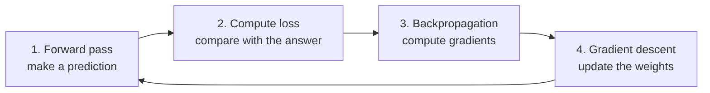
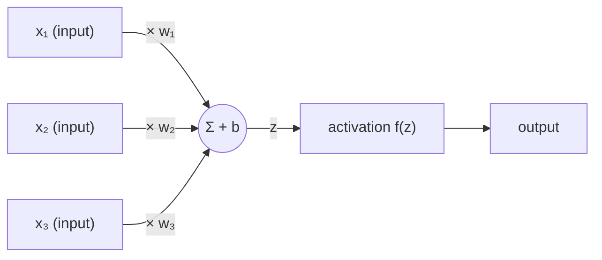
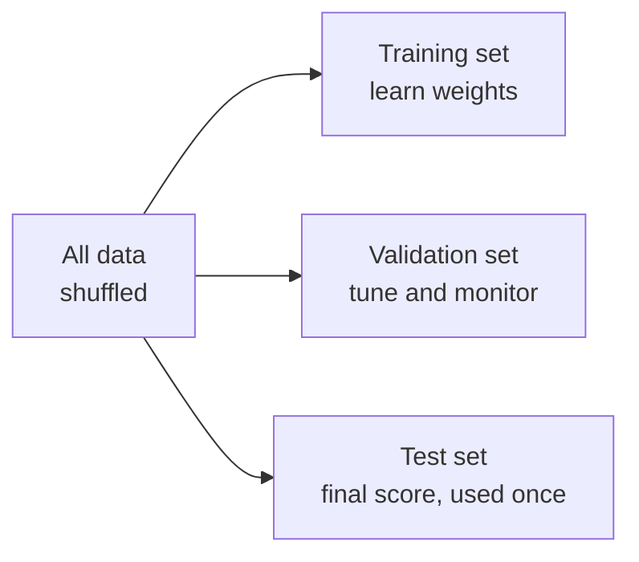
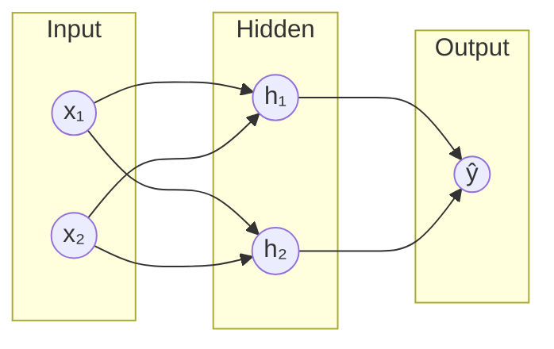
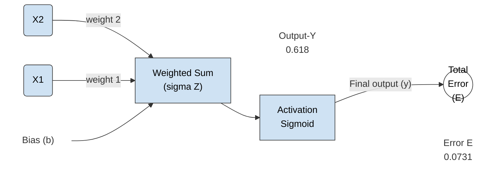

# 1.1 Context and History

Connectionist AI developed from the idea that computers could imitate certain aspects of how the human brain processes information. Instead of relying only on programmed rules, researchers explored networks of artificial neurons that could learn patterns from data [6].

Its development involved several important stages, including early neuron models, the perceptron, periods of setbacks, the revival of backpropagation, and the deep learning boom [6][9].

**Early Neuron Models**

The idea of artificial neurons began in the 1940s, when researchers Warren McCulloch and Walter Pitts introduced a mathematical model of a biological neuron in 1943 [1].

Their model showed how simplified artificial neurons could receive inputs and produce outputs based on logical operations. This became one of the earliest foundations of neural networks [1][6].

Unlike real biological neurons, these artificial neurons used mathematical calculations to represent how information could be processed [1][9].

**Main Idea:**
- Artificial neurons receive inputs.
- They process information using mathematical rules.
- They produce an output depending on the inputs.

**Visual Representation:**

    INPUTS
      |
      v
    +----------------+
    | Artificial     |
    | Neuron         |
    +----------------+
      |
      v
    OUTPUT

This early research introduced the possibility of building computer systems inspired by the human brain.

**The Perceptron**

In 1958, psychologist Frank Rosenblatt introduced the **Perceptron**, an early type of artificial neural network [2].

The perceptron was designed to learn how to classify information into different categories. It could adjust its weights based on training examples, allowing it to improve its predictions [2].

For example, a perceptron could be trained to distinguish between two categories by learning from examples of each category.

**How It Works:**

1. Receives input values.
2. Assigns weights to each input.
3. Calculates a weighted sum.
4. Uses an activation function to produce an output.
5. Adjusts its weights when its prediction is incorrect.

**Visual Representation:**

    INPUTS
      |
      v
    +------------------+
    | Assign Weights   |
    +------------------+
      |
      v
    +------------------+
    | Calculate Sum    |
    +------------------+
      |
      v
    +------------------+
    | Activation       |
    | Function         |
    +------------------+
      |
      v
    +------------------+
    | Classification   |
    +------------------+

The perceptron was an important development because it demonstrated that machines could learn from examples instead of relying entirely on manually written instructions [2][6].

However, early perceptrons had limitations. A single-layer perceptron could only solve problems that were linearly separable, meaning the categories could be separated using a straight line or a similar linear boundary [3].

**Setbacks in Connectionist AI**

Despite the early excitement surrounding perceptrons, researchers soon discovered important limitations.

In 1969, Marvin Minsky and Seymour Papert published a book called *Perceptrons*, which discussed the limitations of single-layer perceptrons [3].

One famous example was the **XOR problem** [3].

A single-layer perceptron could not correctly solve XOR because its outputs could not be separated using a single straight line [3].

**XOR Example:**

| Input A | Input B | Output |
|---|---|---|
| 0 | 0 | 0 |
| 0 | 1 | 1 |
| 1 | 0 | 1 |
| 1 | 1 | 0 |

This problem demonstrated that simple perceptrons could not solve every type of classification task [3].

**Other Challenges:**
- Limited computing power made larger neural networks difficult to develop [4][6].
- Training more complex networks was challenging [4][6].
- Researchers lacked effective methods for adjusting weights across multiple layers [4][5].

As a result, interest and funding for neural network research decreased during periods often associated with the **AI Winter** [4][6].

**Visual Timeline:**

    Early Neural Networks
             |
             v
        Perceptron
             |
             v
      Technical Limitations
             |
             v
       Reduced Interest
             |
             v
          AI Winter

Although progress slowed, researchers continued exploring ways to improve neural networks.

**Revival of Backpropagation**

Interest in neural networks increased again during the 1980s, partly due to the development and wider recognition of **backpropagation** [5][6].

Backpropagation is a training algorithm that allows neural networks with multiple layers to adjust their weights more effectively [5].

Unlike a single-layer perceptron, a multi-layer neural network can learn more complicated patterns by processing information through hidden layers [5][8].

Backpropagation works by calculating the error between a network's prediction and the correct answer, then sending information about that error backward through the network to determine how its weights should change [5][8].

**How Backpropagation Works:**

1. The network receives input data.
2. It produces a prediction.
3. The prediction is compared with the correct answer.
4. The network calculates the error.
5. The error is propagated backward through the network.
6. The weights are adjusted to reduce the error.

**Visual Representation:**

          INPUT DATA
               |
               v
        +--------------+
        | Input Layer  |
        +--------------+
               |
               v
        +--------------+
        | Hidden Layer |
        +--------------+
               |
               v
        +--------------+
        | Output Layer |
        +--------------+
               |
               v
           PREDICTION
               |
               v
         Calculate Error
               |
               v
       BACKPROPAGATION
               |
               v
         Adjust Weights
               |
               +-------> Repeat Training

Backpropagation made it more practical to train multi-layer neural networks and helped researchers overcome some of the limitations of earlier models [5].

In 1986, David Rumelhart, Geoffrey Hinton, and Ronald Williams published influential research demonstrating how backpropagation could help neural networks learn internal representations [5].

This contributed significantly to the renewed interest in connectionist AI [5][6][9].

**The Deep Learning Boom**

During the 2000s and especially the 2010s, connectionist AI experienced major improvements due to advances in computing power, larger datasets, and better training techniques [6][8].

This period became known as the **Deep Learning Boom** [6].

Deep learning uses neural networks with multiple layers to learn increasingly complex patterns from data [8].

Several developments contributed to its growth:

- **More Data:** The growth of the internet created enormous amounts of digital data for training AI systems [6][7].
- **Greater Computing Power:** GPUs made it possible to train larger neural networks more efficiently [6][7].
- **Improved Algorithms:** New techniques helped neural networks train more effectively [6][8].
- **Better Results:** Deep learning achieved major improvements in tasks such as image recognition, speech recognition, and natural language processing [7][8].

**Important Milestone: AlexNet (2012)**

One major breakthrough occurred in 2012 when a deep neural network called **AlexNet** achieved outstanding results in the ImageNet image recognition competition [7].

AlexNet used multiple layers of artificial neurons and GPUs to recognize objects in images [7].

Its success demonstrated the potential of deep learning and encouraged further research and investment in neural networks [7][8].

**Visual Representation:**

    MORE DIGITAL DATA
            |
            v
    GREATER COMPUTING POWER
            |
            v
      IMPROVED ALGORITHMS
            |
            v
    +----------------------+
    |   DEEP NEURAL        |
    |   NETWORKS           |
    +----------------------+
            |
            v
      BETTER AI RESULTS
            |
     +------+------+------+
     |      |      |      |
     v      v      v      v
   Images Speech  Text  Other
          Recognition Processing Tasks

Today, deep learning is used in many areas, including [8]:
- Image and facial recognition.
- Speech recognition and voice assistants.
- Language translation.
- Recommendation systems.
- Generative AI tools.

**Historical Timeline**

| Year / Period | Development | Importance |
|---|---|---|
| 1943 | McCulloch and Pitts' artificial neuron model [1]. | Introduced an early mathematical model of artificial neurons. |
| 1958 | Rosenblatt's Perceptron [2]. | Demonstrated that machines could learn from examples. |
| 1969 | *Perceptrons* by Minsky and Papert [3]. | Highlighted limitations of single-layer perceptrons. |
| 1970s | AI Winter [4]. | Interest in neural network research decreased. |
| 1980s | Revival of backpropagation [5][6]. | Made training multi-layer neural networks more practical. |
| 1986 | Research by Rumelhart, Hinton, and Williams [5]. | Helped popularize backpropagation. |
| 2012 | AlexNet wins the ImageNet competition [7]. | Demonstrated the potential of deep learning. |
| 2010s–Present | Deep Learning Boom [6][8]. | Neural networks became widely used in modern AI applications. |

**References**

1. McCulloch, W. S. and Pitts, W. (1943). *A Logical Calculus of the Ideas Immanent in Nervous Activity.* Bulletin of Mathematical Biophysics, 5, 115–133. https://doi.org/10.1007/BF02478259
2. Rosenblatt, F. (1958). *The Perceptron: A Probabilistic Model for Information Storage and Organization in the Brain.* Psychological Review, 65(6), 386–408. https://doi.org/10.1037/h0042519
3. Minsky, M. and Papert, S. (1969). *Perceptrons: An Introduction to Computational Geometry.* MIT Press.
4. Russell, S. and Norvig, P. (2021). *Artificial Intelligence: A Modern Approach* (4th ed.). Pearson. Chapter 1 (history of AI).
5. Rumelhart, D. E., Hinton, G. E., and Williams, R. J. (1986). *Learning Representations by Back-Propagating Errors.* Nature, 323, 533–536. https://doi.org/10.1038/323533a0
6. Goodfellow, I., Bengio, Y., and Courville, A. (2016). *Deep Learning.* MIT Press, Chapter 1 (Section 1.2, Historical Trends in Deep Learning). https://www.deeplearningbook.org/
7. Krizhevsky, A., Sutskever, I., and Hinton, G. E. (2012). *ImageNet Classification with Deep Convolutional Neural Networks.* Advances in Neural Information Processing Systems 25. https://proceedings.neurips.cc/paper_files/paper/2012/file/c399862d3b9d6b76c8436e924a68c45b-Paper.pdf
8. LeCun, Y., Bengio, Y., and Hinton, G. (2015). *Deep Learning.* Nature, 521, 436–444. https://doi.org/10.1038/nature14539
9. Shao, F. and Shen, Z. (2023). *How Can Artificial Neural Networks Approximate the Brain?* Frontiers in Psychology, 13, 970214. https://doi.org/10.3389/fpsyg.2022.970214

---

# 1.2 Key Characteristics

Connectionist AI has several important characteristics that explain how it learns and processes information. These characteristics are inspired by the way the human brain works [2][3].

**Requires a Lot of Data**

Connectionist AI often requires a large amount of data to learn effectively [2][4]. Instead of relying entirely on instructions written by humans, it studies examples to recognize patterns [1].

For example, if we want to teach an AI to recognize cats, we need to provide it with many pictures of cats. These pictures should include different breeds, colors, sizes, and positions. By studying these examples, the AI can learn to recognize cats in new pictures [1].

**Many Simple Units Working in Parallel**

Connectionist AI uses many small processing units called artificial neurons. Each neuron performs a relatively simple calculation, but thousands or millions of neurons can work together to complete complex tasks [2][3].

For example, when recognizing a face, different groups of neurons may learn to recognize eyes, noses, mouths, and other facial features. Together, these patterns help the AI identify the face [1].

**Visual Representation:**

    INPUT: FACE IMAGE
           |
    +------+------+------+
    |      |      |      |
    v      v      v
    +----+ +----+ +----+
    | G1 | | G2 | | G3 |
    +----+ +----+ +----+
      |      |      |
      v      v      v
     Eyes   Nose   Mouth
      |      |      |
      +------+------+ 
             |
             v
      COMBINE PATTERNS
             |
             v
       FACE RECOGNIZED

**Tolerates Noisy Input**

Noisy input refers to information that is unclear, incomplete, distorted, or contains unwanted details.

Connectionist AI can sometimes recognize patterns even when the input is not perfect [5].

For example, an AI trained to recognize handwritten numbers may still identify the number 8 even if the handwriting is messy, tilted, or slightly distorted. This is possible because it has learned patterns from many handwriting examples [5].

**Example:**

| Input | Result |
|---|---|
| Clearly written `8` | Recognized as 8 |
| Tilted `8` | Recognized as 8 |
| Messy handwritten `8` | May still be recognized as 8 |

**Learns from Examples**

Connectionist AI learns by studying examples instead of requiring humans to manually program every possible rule [1][2].

For example, to teach an AI to recognize spam emails, we provide it with many emails labeled as either "Spam" or "Not Spam". The AI studies the patterns in these emails and uses what it learns to classify new messages [1].

**Learning Process:**

    TRAINING EXAMPLES
           |
           v
    +----------------+
    | Neural Network |
    +----------------+
           |
           v
     Studies Patterns
           |
           v
     Adjusts Connections
           |
           v
       Learns Patterns
           |
           v
     Classifies New Emails

**References**

1. LeCun, Y., Bengio, Y., and Hinton, G. (2015). *Deep Learning.* Nature, 521, 436–444 (see "Supervised learning" and the discussion of layers of learned features). https://doi.org/10.1038/nature14539
2. Goodfellow, I., Bengio, Y., and Courville, A. (2016). *Deep Learning.* MIT Press, Chapter 1 (Section 1.2, Historical Trends in Deep Learning). https://www.deeplearningbook.org/
3. Rumelhart, D. E., McClelland, J. L., and the PDP Research Group (1986). *Parallel Distributed Processing: Explorations in the Microstructure of Cognition, Volume 1: Foundations.* MIT Press.
4. Krizhevsky, A., Sutskever, I., and Hinton, G. E. (2012). *ImageNet Classification with Deep Convolutional Neural Networks.* Advances in Neural Information Processing Systems 25. https://proceedings.neurips.cc/paper_files/paper/2012/file/c399862d3b9d6b76c8436e924a68c45b-Paper.pdf
5. LeCun, Y., Bottou, L., Bengio, Y., and Haffner, P. (1998). *Gradient-Based Learning Applied to Document Recognition.* Proceedings of the IEEE, 86(11), 2278–2324. https://doi.org/10.1109/5.726791

---

# 1.3 Knowledge Stored in Connections

In Connectionist AI, knowledge is represented through the connections between artificial neurons [1][4]. These connections have numerical values called **weights**, which determine how strongly one neuron influences another [1][4].

**Weights as Memory**

Weights act like a form of memory in a neural network. They represent the importance of different connections and patterns learned during training [1].

For example, when learning to recognize cats, a neural network may develop stronger responses to patterns such as pointed ears, whiskers, and certain facial features. These learned patterns are reflected in the network's weights [5].

**Visual Representation:**

    NEURON A                    NEURON C
    +---------+                 +---------+
    |         |                 |         |
    |    A    |---------------->|    C    |
    |         |   Weight: 0.8   |         |
    +---------+                 +---------+
                                     ^
                                     |
    NEURON B                         |
    +---------+                      |
    |         |----------------------+
    |    B    |    Weight: 0.3
    |         |
    +---------+

A higher weight means that a connection has a stronger influence on the receiving neuron. A lower weight means that its influence is weaker [4].

**Learning Through Adjusting Weights**

Learning in a neural network happens when its weights are adjusted to improve predictions. During training, the network makes predictions, compares them with the correct answers, and adjusts its weights to reduce mistakes [2][5].

For example, if an AI incorrectly identifies an apple as an orange, its training process adjusts the weights so that it can become better at distinguishing between the two objects.

One common method used to adjust weights is called **backpropagation** [2][5].

**Learning Process:**

    INPUT DATA
        |
        v
    +----------------+
    | Neural Network |
    +----------------+
        |
        v
     Prediction
        |
        v
    Compare with Correct Answer
        |
        v
     Calculate Error
        |
        v
     Adjust Weights
        |
        +-----------> Repeat Training

The process repeats during training so that the network can gradually improve its predictions [2].

**Distributed Representations**

Distributed representation means that knowledge is spread across multiple artificial neurons instead of being stored in just one neuron [3][4].

For example, when recognizing a car, different neurons may respond to its color, shape, wheels, and other features. Together, these neurons create a representation of the object [3][5].

**Visual Representation:**

          OBJECT: RED CAR
                |
       +--------+--------+
       |        |        |
       v        v        v
    +------+ +------+ +------+
    | Red  | | Shape| |Wheels|
    |Color | |      | |      |
    +------+ +------+ +------+
       |        |        |
       +--------+--------+
                |
                v
      COMBINED REPRESENTATION
                |
                v
          RECOGNIZES
            RED CAR

This allows the network to recognize different objects using combinations of learned patterns [3].

**Simple Analogy:**

Think of a group project. One student knows about colors, another understands shapes, and another recognizes objects. Together, they can identify different things. No single student holds all the knowledge.

**References**

1. Rumelhart, D. E., McClelland, J. L., and the PDP Research Group (1986). *Parallel Distributed Processing: Explorations in the Microstructure of Cognition, Volume 1: Foundations.* MIT Press.
2. Rumelhart, D. E., Hinton, G. E., and Williams, R. J. (1986). *Learning Representations by Back-Propagating Errors.* Nature, 323, 533–536. https://doi.org/10.1038/323533a0
3. Hinton, G. E., McClelland, J. L., and Rumelhart, D. E. (1986). *Distributed Representations.* In *Parallel Distributed Processing, Volume 1* (pp. 77–109). MIT Press.
4. Goodfellow, I., Bengio, Y., and Courville, A. (2016). *Deep Learning.* MIT Press, Chapter 6 (Deep Feedforward Networks) and Chapter 15 (Representation Learning). https://www.deeplearningbook.org/
5. LeCun, Y., Bengio, Y., and Hinton, G. (2015). *Deep Learning.* Nature, 521, 436–444. https://doi.org/10.1038/nature14539

---

# 1.4 Traditional Machine Learning

Traditional machine learning and Connectionist AI are both approaches to machine learning. However, they can differ in how they process data, use computing resources, and identify important features [1][2].

**Data and Computing Requirements**

Traditional machine learning models can often work with smaller datasets and require less computing power, depending on the task [1].

In comparison, connectionist models, especially deep neural networks, often benefit from larger datasets and more computing power because they learn complex patterns through multiple layers of artificial neurons [1][2].

For example, a traditional machine learning model predicting house prices might use information such as house size, location, and number of bedrooms. A neural network can also use these features while learning more complicated relationships between them.

**Comparison:**

| Traditional Machine Learning | Connectionist AI |
|---|---|
| Can often work with smaller datasets [1]. | Often benefits from larger datasets [1][2]. |
| Usually requires less computing power [1]. | Can require more computing power [1][2]. |
| Often uses manually selected features [2][3]. | Can automatically learn features [2][3]. |

**Hand-Made Features vs. Learned Features**

A feature is a piece of information that helps an AI make a prediction.

In traditional machine learning, humans often select and prepare the features that the model will use. This process is called **feature engineering** [2][3].

For example, when creating a system to recognize cats, humans might manually select features such as fur color, ear shape, and eye shape. The model then learns how to use these features.

In Connectionist AI, especially deep learning, neural networks can automatically learn useful features from the training data [2][3].

For example [2]:
- Early layers may recognize edges and simple shapes.
- Middle layers may recognize parts of objects.
- Later layers may recognize complex patterns, such as a cat's face.

**Visual Comparison:**

    TRADITIONAL MACHINE LEARNING

             CAT IMAGE
                 |
                 v
        HUMAN SELECTS FEATURES
                 |
         +-------+-------+
         |       |       |
         v       v       v
        Fur     Ears    Eyes
         |       |       |
         +-------+-------+
                 |
                 v
         MACHINE LEARNING
                 |
                 v
             PREDICTION


          CONNECTIONIST AI

             CAT IMAGE
                 |
                 v
         +---------------+
         | Neural Network|
         +---------------+
                 |
                 v
         Learns Simple Features
                 |
                 v
         Learns Complex Features
                 |
                 v
             PREDICTION

**Comparison Table**

| Traditional Machine Learning | Connectionist AI |
|---|---|
| Humans often select important features [2][3]. | The network can learn features automatically [2][3]. |
| Can often work with smaller datasets [1]. | Often benefits from larger datasets [1][2]. |
| Usually requires less computing power [1]. | Can require more computing power [1][2]. |
| Often easier to interpret [4]. | Can be harder to interpret [4]. |

**References**

1. Goodfellow, I., Bengio, Y., and Courville, A. (2016). *Deep Learning.* MIT Press, Chapter 1 (Introduction) and Chapter 5 (Machine Learning Basics). https://www.deeplearningbook.org/
2. LeCun, Y., Bengio, Y., and Hinton, G. (2015). *Deep Learning.* Nature, 521, 436–444. https://doi.org/10.1038/nature14539
3. Bengio, Y., Courville, A., and Vincent, P. (2013). *Representation Learning: A Review and New Perspectives.* IEEE Transactions on Pattern Analysis and Machine Intelligence, 35(8), 1798–1828. https://doi.org/10.1109/TPAMI.2013.50
4. Rudin, C. (2019). *Stop Explaining Black Box Machine Learning Models for High Stakes Decisions and Use Interpretable Models Instead.* Nature Machine Intelligence, 1, 206–215. https://doi.org/10.1038/s42256-019-0048-x

---

# 1.5 Biological vs Artificial Neuron; Connectionist vs Symbolic AI

Connectionist AI was inspired by the way the human brain processes information. However, artificial neurons are simplified mathematical models rather than exact copies of biological neurons [3][5].

**Biological Neurons**

A biological neuron is a specialized nerve cell that receives, processes, and sends information throughout the nervous system [1].

Its main parts include [1]:

| Part | Function |
|---|---|
| Dendrites | Receive signals from other neurons. |
| Cell Body (Soma) | Combines and processes incoming signals. |
| Axon | Carries signals away from the cell body. |
| Synapses | Connection points where neurons communicate. |

**Visual Representation:**

          DENDRITES
         \    |    /
          \   |   /
           \  |  /
         +---------+
         |  CELL   |
         |  BODY   |
         |  (SOMA) |
         +---------+
              |
              |
              v
       ====================>
               AXON
                           |
                           v
                     AXON TERMINALS
                           |
                           v
                        SYNAPSES
                           |
                           v
                      NEXT NEURON

**How Does It Work?**

1. Dendrites receive signals from other neurons [1].
2. The cell body combines these signals [1][2].
3. If the neuron reaches the necessary activation threshold, it produces an electrical impulse [2].
4. The axon carries the impulse to other cells [1][2].

**Artificial Neurons**

An artificial neuron is a simplified mathematical model inspired by a biological neuron [3][4]. Instead of using real electrical and chemical signals, it processes numerical information [4].

Its main components include [4]:

| Component | Function |
|---|---|
| Inputs | Receive numerical information. |
| Weights | Determine the importance of each input. |
| Summation | Combines the weighted inputs. |
| Activation Function | Determines the neuron's output. |
| Output | Passes processed information to other neurons. |

**Visual Representation:**

    INPUTS              PROCESSING             OUTPUT

    x₁ ---- w₁ ---\
                   \
    x₂ ---- w₂ ----+---> Weighted Sum
                   /          |
    x₃ ---- w₃ ---/           v
                         Activation
                           Function
                              |
                              v
                            OUTPUT

Each input has a weight that determines how much it contributes to the final result [4].

For example, imagine an artificial neuron deciding whether an email is spam. It receives information about suspicious words, unknown links, and the sender. It combines these inputs and produces an output that contributes to the spam prediction.

**Biological vs Artificial Neurons**

| Biological Neuron | Artificial Neuron |
|---|---|
| Dendrites receive signals [1]. | Inputs receive numerical information [4]. |
| Synapses influence signal strength [1][2]. | Weights control connection strength [4]. |
| Cell body combines incoming signals [1]. | Summation combines weighted inputs [4]. |
| Neuron activation produces an electrical impulse [2]. | Activation function calculates an output [4]. |
| Axon transmits signals [1]. | Output passes information onward [4]. |

Although both neurons receive and process information, biological neurons use complex electrical and chemical processes, while artificial neurons perform mathematical calculations [1][5].

**Connectionist AI vs Symbolic AI**

Connectionist AI and Symbolic AI are two different approaches to creating artificial intelligence. They mainly differ in how they represent knowledge and solve problems [5][6][7].

Connectionist AI learns patterns from examples through interconnected artificial neurons. Its knowledge is represented through connection weights that are adjusted during training [4][5].

Symbolic AI uses predefined rules, symbols, and logical reasoning. Instead of learning everything from examples, it follows instructions created by humans [6][7].

For example, imagine creating an AI system to determine whether someone qualifies for a student discount.

- **Symbolic AI:** Uses a predefined rule such as "IF the person is a student, THEN they qualify for a student discount."
- **Connectionist AI:** Learns patterns from examples of people who qualify and do not qualify for the discount.

**Visual Comparison:**

    ARTIFICIAL INTELLIGENCE
              |
       +------+------+
       |             |
       v             v
  CONNECTIONIST AI  SYMBOLIC AI
       |             |
       v             v
  Training Examples Written Rules
       |             |
       v             v
  Neural Network   Logical Reasoning
       |             |
       v             v
  Learned Patterns  Decision
       |             |
       v             v
   Prediction       Output

**Comparison Table**

| Comparison | Connectionist AI | Symbolic AI |
|---|---|---|
| Main Approach | Learns patterns from data [5]. | Uses predefined rules and logic [6][7]. |
| Knowledge | Stored in connection weights [4]. | Stored as symbols and rules [6]. |
| Learning | Adjusts weights during training [4]. | Rules are often manually created [7]. |
| Data Requirements | Often needs many training examples [4]. | Can work with relatively little training data [7]. |
| Best Suited For | Pattern recognition and complex data [4]. | Explicit rules and logical reasoning [6][7]. |
| Example | Image recognition neural networks [4]. | Rule-based expert systems [7]. |

**Explainability**

Explainability refers to how easily humans can understand why an AI system produces a particular result [8][9].

Symbolic AI is generally easier to explain because its decisions follow explicit rules that can be examined [7][8].

Connectionist AI can be harder to explain because its decisions may depend on thousands or millions of interconnected weights. This makes it difficult to identify exactly how each connection contributes to a prediction [8][9].

For this reason, neural networks are sometimes described as **black-box models** [8].

**Example: Loan Application**

Imagine an AI system deciding whether to approve a loan application.

- **Symbolic AI:** Might reject the application because the applicant does not meet a specific written requirement.
- **Connectionist AI:** Might reject the application based on many learned patterns, without providing a simple explanation of how each factor contributed.

**References**

1. National Institute of Neurological Disorders and Stroke (NINDS). *Life and Death of a Neuron (Brain Basics).* https://www.ninds.nih.gov/publications/life-and-death-neuron-brain-basics
2. Kandel, E. R., Koester, J. D., Mack, S. H., and Siegelbaum, S. A. (2021). *Principles of Neural Science* (6th ed.). McGraw-Hill.
3. McCulloch, W. S. and Pitts, W. (1943). *A Logical Calculus of the Ideas Immanent in Nervous Activity.* Bulletin of Mathematical Biophysics, 5, 115–133. https://doi.org/10.1007/BF02478259
4. Goodfellow, I., Bengio, Y., and Courville, A. (2016). *Deep Learning.* MIT Press, Chapter 6 (Deep Feedforward Networks). https://www.deeplearningbook.org/
5. Shao, F. and Shen, Z. (2023). *How Can Artificial Neural Networks Approximate the Brain?* Frontiers in Psychology, 13, 970214. https://doi.org/10.3389/fpsyg.2022.970214
6. Newell, A. and Simon, H. A. (1976). *Computer Science as Empirical Inquiry: Symbols and Search.* Communications of the ACM, 19(3), 113–126. https://doi.org/10.1145/360018.360022
7. Russell, S. and Norvig, P. (2021). *Artificial Intelligence: A Modern Approach* (4th ed.). Pearson. Chapter 1.
8. Rudin, C. (2019). *Stop Explaining Black Box Machine Learning Models for High Stakes Decisions and Use Interpretable Models Instead.* Nature Machine Intelligence, 1, 206–215. https://doi.org/10.1038/s42256-019-0048-x
9. Phillips, P. J. et al. (2021). *Four Principles of Explainable Artificial Intelligence.* NISTIR 8312, National Institute of Standards and Technology. https://doi.org/10.6028/NIST.IR.8312

# 2.1 How Networks Learn

---

## Explanations

A neural network learns by **adjusting its weights** (the numbers inside it that control its behavior) until its predictions get close to the correct answers. Learning is a loop of three jobs:

| Job | Question it answers | Tool |
|---|---|---|
| **Measure the error** | How wrong is the network right now? | Loss function |
| **Find the blame** | How much did each weight contribute to the error? | Backpropagation |
| **Fix the weights** | Which way, and how far, should each weight move? | Gradient descent |

### Gradient descent and loss
The **loss** is a single number saying how wrong the network is. Lower is better. Training means finding weights that make the loss as small as possible.

Picture the loss as a hilly landscape and the weight as a ball. The **gradient** is the slope under the ball. It points uphill, so we step in the **opposite** direction (downhill):

```text
new weight = old weight − learning rate × gradient
```

### Backpropagation
A real network has millions of weights, so we need each weight's gradient quickly. **Backpropagation** does this with the **chain rule** (a calculus rule for combining small effects into one big effect). It starts at the loss, works backward layer by layer, and reuses earlier results.

> ⚠️ **Common mix-up:** backpropagation only *computes* the gradients. Gradient descent *uses* them to update the weights. They are two separate steps.

### The training process
Each training step repeats four moves, shown here as a loop:



The loop runs over the training data many times. Data is usually fed in small groups called **batches**, and one full pass over all the data is an **epoch**.

### Good to know

1. **Different tasks use different loss functions.** *Mean squared error* (MSE) is common when predicting numbers, like a house price. *Cross-entropy* is common when choosing a category, like cat or dog.
2. **Real networks have many weights.** Each weight gets its **own gradient** and is updated by the same rule. The worked example uses one weight only to keep the numbers readable.
3. **Backpropagation needs the forward pass.** The values calculated on the way forward are stored, then reused on the way back. That is why the forward pass always comes first.
4. **Watch the loss to diagnose training.** If loss falls steadily, learning is working. If it bounces up and down or grows, the learning rate is usually too high. If it barely moves, it may be too low. Training stops when the loss stops improving. Falling loss on training data alone does not prove the network is good, which is the topic of *Overfitting and Generalisation*.

---

## Terminology

| Term | Meaning |
|---|---|
| **Weight / parameter** | A number inside the network that is adjusted during learning |
| **Loss function** | A formula that turns the network's error into one number |
| **Gradient** | The slope of the loss for a weight: which way and how steeply the loss rises |
| **Learning rate** | The step size of each update. Too small is slow. Too large overshoots |
| **Chain rule** | Calculus rule that multiplies small effects together to get a total effect |
| **Batch** | A small group of training examples used for one update |
| **Epoch** | One full pass through the whole training set |

---

## Worked example: one weight learning

**Setup:** the network is just `prediction = w × x`. The input is `x = 2` and the correct answer is `4`, so the ideal weight is `w = 2`. Loss = `(prediction − 4)²`. Learning rate = `0.05`. Start at `w = 0`.

**Backpropagation on this tiny network** (chain rule):

```text
dLoss/dw = dLoss/dprediction × dprediction/dw
         = 2 × (prediction − 4)  ×  x
```

**Training steps:**

| Step | w | Prediction (w×2) | Loss | Gradient = 2(pred − 4)×2 | New w = w − 0.05 × gradient |
|---|---|---|---|---|---|
| 0 | 0 | 0 | 16 | −16 | 0 + 0.8 = **0.8** |
| 1 | 0.8 | 1.6 | 5.76 | −9.6 | 0.8 + 0.48 = **1.28** |
| 2 | 1.28 | 2.56 | 2.07 | −5.76 | 1.28 + 0.288 = **1.568** |

**What to notice:** the loss falls each step (16 → 5.76 → 2.07) and `w` moves toward 2. Steps get smaller because the slope gets flatter near the bottom.

---

## Learner activity

**Task 1.** Using the same setup, calculate **Step 3** starting from `w = 1.568`. Fill in the prediction, loss, gradient and new `w`.

**Task 2.** Redo **Step 0** with a larger learning rate of `0.3`. What is the new `w`, the new prediction, and the new loss? Compare the new loss with the starting loss of 16 and explain what happened.

---

## Answers and expected outcomes

<details>
<summary><b>Click to reveal</b></summary>

**Task 1**

| Prediction | Loss | Gradient | New w |
|---|---|---|---|
| 1.568 × 2 = **3.136** | (3.136 − 4)² ≈ **0.7465** | 2 × (−0.864) × 2 = **−3.456** | 1.568 + 0.05 × 3.456 = **1.7408** |

**Task 2**
- Gradient at Step 0 is still −16, so new `w = 0 − 0.3 × (−16) = 4.8`.
- New prediction = 4.8 × 2 = **9.6**, new loss = (9.6 − 4)² = **31.36**.
- The loss went **up** from 16 to 31.36. The step was too big, so `w` jumped past the ideal value of 2 and landed on the other side of the valley. This is **overshooting**.

**Expected outcome:** the learner can apply the update rule by hand and explain that the learning rate controls step size, with too large a value causing overshooting.

**Teacher check:** ask, "What is the difference between backpropagation and gradient descent?" A good answer: backpropagation computes each weight's gradient, and gradient descent uses the gradients to update the weights.

</details>

---

## References

1. Cornell Virtual Workshop. *Gradient Descent.* https://cvw.cac.cornell.edu/SciML/mlp/gradient-descent
2. Cornell University, CS 4780. *The Backpropagation Algorithm* (lecture notes). https://www.cs.cornell.edu/courses/cs4780/2023fa/lectures/note_backprop.pdf
3. Wikipedia. *Backpropagation.* https://en.wikipedia.org/wiki/Backpropagation
4. apxml.com. *Introduction to Deep Learning: Learning Rate.* https://apxml.com/courses/introduction-to-deep-learning/chapter-3-training-loss-optimization/learning-rate
   

# 2.2 Inside One Neuron

> **Chapter:** Connectionist AI · **Section:** Basics of Neural Networks · **Level:** Beginner  
> **Covers:** inputs, bias and weights · weighted sum · activation function

---

## Explanations

An **artificial neuron** is the basic building block of a neural network. It takes in several numbers, does a small calculation, and produces **one** output number. That output can become an input for other neurons.

Every neuron does the same three things, in order:

1. **Weigh** each input by multiplying it by its weight.
2. **Sum** the weighted inputs and add the bias. This gives one number, `z`.
3. **Activate**: pass `z` through an activation function to get the output.

```text
output = f( w₁x₁ + w₂x₂ + … + wₙxₙ + b )
```

### Inputs, weights and bias
- **Inputs (x):** the numbers going in. They are either the raw data or the outputs of the previous layer.
- **Weights (w):** one per input. A weight says how **important** its input is. A large positive weight pushes the neuron up, a negative weight pushes it down, and a weight near zero means the input is mostly ignored.
- **Bias (b):** one extra number per neuron, added to the sum. It shifts how easily the neuron switches on, even when every input is zero.

Weights and biases are the **learnable parameters**. Training (the previous lesson) adjusts them.

### Weighted sum
Multiply each input by its weight, add the results, then add the bias. The result `z` is called the **pre-activation value**.

### Activation function
The **activation function** `f` turns `z` into the neuron's final output. It matters because without it, stacking layers would collapse into one simple linear calculation, which cannot learn complex patterns. The activation function adds **non-linearity**.

| Function | Rule | Output range | Behavior |
|---|---|---|---|
| **Step** | 1 if `z > 0`, otherwise 0 | 0 or 1 | On/off switch |
| **Sigmoid** | `1 / (1 + e⁻ᶻ)` | between 0 and 1 | Smooth S-curve, squashes any `z` |
| **ReLU** | `max(0, z)` | 0 and above | Blocks negatives, passes positives |

### Visual: one neuron



> The design is loosely inspired by a biological neuron (inputs ≈ dendrites, weights ≈ connection strength, output ≈ axon), but an artificial neuron is only a simple math formula.

---

## Terminology

| Term | Meaning |
|---|---|
| **Neuron (node)** | A unit that takes inputs and produces one output |
| **Input (x)** | A number fed into the neuron |
| **Weight (w)** | A learnable number that scales its input's importance |
| **Bias (b)** | A learnable number added to the sum, shifting when the neuron activates |
| **Weighted sum (z)** | Σ(w × x) + b, the value before activation |
| **Activation function (f)** | Turns `z` into the neuron's output and adds non-linearity |
| **Non-linearity** | Behavior that is not a straight-line relationship, needed to learn complex patterns |

---

## Worked example: "Should I go out to play?"

One neuron decides whether to go outside. Inputs are `1` for yes and `0` for no.

| Input | Meaning | Value (x) | Weight (w) |
|---|---|---|---|
| x₁ | It is sunny | 1 | **0.6** |
| x₂ | Friends are going | 1 | **0.5** |
| x₃ | Homework is still not done | 1 | **−0.8** |

Bias `b = −0.2` (a small built-in reluctance to go out).

| Step | Calculation | Result |
|---|---|---|
| 1. Weigh | 0.6×1, 0.5×1, −0.8×1 | 0.6, 0.5, −0.8 |
| 2. Sum | 0.6 + 0.5 + (−0.8) | 0.3 |
| 3. Add bias | 0.3 + (−0.2) | **z = 0.1** |
| 4a. Activate (ReLU) | max(0, 0.1) | **0.1** |
| 4b. Activate (Sigmoid) | 1 / (1 + e⁻⁰·¹) | **≈ 0.525** |

**What to notice:** the negative weight on homework pulled the total down from 1.1 to 0.3. Sigmoid shows the neuron is only slightly leaning toward "go" (a little above 0.5). The same `z` gives different outputs under different activation functions.

---

## Learner activity

Use the same weights (`0.6`, `0.5`, `−0.8`) and bias (`−0.2`).

**Task 1.** It is **rainy** (x₁ = 0), **friends are going** (x₂ = 1), and **homework is done** (x₃ = 0). Find `z`, the ReLU output, and the sigmoid output.

**Task 2.** Now **every input is 0**. What is `z`, and what does this show about the role of the bias?

---

## Answers and expected outcomes

<details>
<summary><b>Click to reveal</b></summary>

**Task 1**

| Weighted terms | Sum | z (after bias) | ReLU | Sigmoid |
|---|---|---|---|---|
| 0, 0.5, 0 | 0.5 | 0.5 − 0.2 = **0.3** | **0.3** | 1 / (1 + e⁻⁰·³) ≈ **0.574** |

**Task 2**
- All weighted terms are 0, so `z = 0 + (−0.2) = −0.2`.
- ReLU gives max(0, −0.2) = **0**, so the neuron is off.
- The bias works even when all inputs are zero. It sets the neuron's **starting tendency**, here a slight lean toward "no".

**Expected outcome:** the learner can compute a neuron's output in three steps (weigh, sum plus bias, activate) and explain that weights set the importance of inputs while bias shifts the starting point.

**Teacher check:** ask, "If we removed the activation function from every neuron, why would a many-layer network be no more powerful than one neuron?" A good answer: each layer would only do weighted sums, and stacked weighted sums collapse into a single weighted sum, so no complex patterns could be learned.

</details>

---

## References

1. Runestone Academy, *AI4All*. "Inputs, Weights, and Biases." https://runestone.academy/ns/books/published/ai4all/sec-inputs-weights-and-biases.html
2. apxml.com. *Introduction to Deep Learning: The Artificial Neuron Model.* https://apxml.com/courses/introduction-to-deep-learning/chapter-1-neural-network-foundations/artificial-neuron-model
3. Towards AI. "How Does a Neural Network Learn? Neurons, Activation Functions and Loss." https://pub.towardsai.net/how-does-a-neural-network-learn-neurons-activation-functions-and-loss-7c92debbc59e
4. CASRAI. "Neural Networks and Deep Learning Explained." https://casrai.org/news/neural-networks-and-deep-learning-explained


# 2.3 Overfitting and Generalisation

---

## Explanations

The goal of training is **not** to do well on the examples the network has already seen. The goal is to do well on **new** examples it has never seen. This ability is called **generalisation**.

### Overfitting
**Overfitting** happens when a network learns the training data too closely, including its random noise and quirks, instead of the real underlying pattern. It scores very well on training data but badly on new data. It is like a student who memorises last year's exam answers: perfect on those exact questions, lost on new ones.

The opposite problem is **underfitting**: the network has not learned enough, so it performs poorly on *both* training and new data.

| | Training performance | New-data performance | Diagnosis |
|---|---|---|---|
| ✅ Good fit | Good | Good | Generalises well |
| ⚠️ Overfitting | Very good | Poor | Memorised the training set |
| ❌ Underfitting | Poor | Poor | Has not learned enough |

### Train, validation and test sets
To *detect* overfitting we must test on data the network did not train on. So the data is shuffled and split into three separate sets:

| Set | Role | Used |
|---|---|---|
| **Training set** | The network learns its weights from it | Over and over during training |
| **Validation set** | Monitor progress and tune settings (like the learning rate) while building | Repeatedly during development |
| **Test set** | One final, unbiased score of real-world performance | Once, at the very end |

Common split ratios are 60/20/20, 70/15/15 and 80/10/10, and there is no single best ratio.



> ⚠️ **Common mix-up:** do not keep checking the test set while building. Once you tune the model to it, it is no longer "unseen" and its score becomes over-optimistic.

### How to spot overfitting
Watch the **training loss** and **validation loss** together:

- Both falling: the network is learning and generalising.
- Training loss falling but **validation loss rising**: **overfitting**.

A simple fix is **early stopping**: stop training when the validation loss stops improving.

---

## Terminology

| Term | Meaning |
|---|---|
| **Generalisation** | Performing well on new data the network has never seen |
| **Overfitting** | Memorising training data (and its noise) so that new-data performance is poor |
| **Underfitting** | Not learning enough, so performance is poor on all data |
| **Noise** | Random quirks or errors in data that carry no real pattern |
| **Training / validation / test set** | Three separate portions of the data, used for learning, tuning and final scoring |
| **Early stopping** | Ending training when validation loss stops improving |
| **Data leakage** | Test information accidentally influencing training or tuning, making scores unrealistically good |

---

## Worked example: spotting the stop point

1,000 photos of cats and dogs are split 70/15/15: **700 training**, **150 validation**, **150 test**. A network trains for six epochs, and both losses are recorded.

| Epoch | Training loss | Validation loss | What is happening |
|---|---|---|---|
| 1 | 0.90 | 0.95 | Learning |
| 2 | 0.60 | 0.68 | Learning |
| 3 | 0.40 | 0.52 | Learning |
| **4** | **0.25** | **0.50** | **Validation loss is lowest** ✅ |
| 5 | 0.12 | 0.55 | Training ↓, validation ↑ ⚠️ |
| 6 | 0.05 | 0.65 | Overfitting getting worse |

**Reading the table:**
1. Epochs 1 to 4: both losses fall, so the network is generalising.
2. Epoch 5: training loss keeps dropping but validation loss turns upward. **Overfitting has started.**
3. The best moment to stop is **epoch 4**, where the validation loss is lowest.
4. Only after stopping do we use the 150 test photos, once, to get the final score.

---

## Learner activity

**Task 1.** A different network gives these results. Which epoch should you stop at, and at which epoch does overfitting start?

| Epoch | Training loss | Validation loss |
|---|---|---|
| 1 | 0.80 | 0.85 |
| 2 | 0.50 | 0.55 |
| 3 | 0.30 | 0.45 |
| 4 | 0.18 | 0.47 |
| 5 | 0.08 | 0.60 |

**Task 2.** You have 200 labelled examples and use a 70/15/15 split. How many go in each set?

**Task 3.** A learner tunes the network's settings again and again, each time checking the test-set score, and keeps the best. Why is this a problem, and what should they have used instead?

---

## Answers and expected outcomes

<details>
<summary><b>Click to reveal</b></summary>

**Task 1**
- Stop at **epoch 3**, where validation loss is lowest (0.45).
- Overfitting starts at **epoch 4**: training loss keeps falling (0.30 → 0.18) while validation loss rises (0.45 → 0.47).

**Task 2**
- Training: 200 × 0.70 = **140**
- Validation: 200 × 0.15 = **30**
- Test: 200 × 0.15 = **30**
- (140 + 30 + 30 = 200 ✔)

**Task 3**
- Repeatedly tuning against the test set leaks information from it into the model choice. The test set is no longer "unseen", so the final score is **over-optimistic** (data leakage).
- They should have used the **validation set** for tuning and kept the test set for a single final evaluation.

**Expected outcome:** the learner can recognise overfitting from diverging training and validation losses, choose a stopping point, and state the separate roles of the three data sets.

**Teacher check:** ask, "A network scores 99% on its training data but 60% on new data. What is wrong, and how would you have caught it earlier?" A good answer: it is overfitting (memorised the training data), and watching the validation loss rise during training would have shown it earlier.

</details>

---

## References

1. Educative. "What is train/test/validation set splitting?" https://www.educative.io/answers/what-is-train-test-validation-set-splitting
2. KodeKloud Notes. *Machine Learning Fundamentals: Overfitting and the Train/Validation/Test Split.* https://notes.kodekloud.com/docs/Machine-Learning-Fundamentals/Generalisation-and-Types-of-Learning/Overfitting-and-the-TrainValidationTest-Split/page
3. Rensselaer Polytechnic Institute, Tetherless World Constellation. *Generalization, Overfitting, Model Validation* (lecture slides, citing *An Introduction to Statistical Learning*). https://tw.rpi.edu/sites/default/files/2024-10/Data_Analytics2024Fall_Group2_Generalization_Overfitting_Validation.pdf
4. Goodfellow, I., Bengio, Y., and Courville, A. (2016). *Deep Learning.* MIT Press, Chapter 5, sections 5.2 (Capacity, Overfitting and Underfitting) and 5.3 (Hyperparameters and Validation Sets). <https://www.deeplearningbook.org/>


# 2.4 Layers and the Forward Pass

---

## Explanations

A neural network arranges neurons into **layers**. Data enters at one end, flows through the layers, and a result comes out the other end. This one-way trip is called the **forward pass**.

### The three kinds of layers

| Layer | Job | Does it calculate? |
|---|---|---|
| **Input layer** | Holds the data going in (one slot per feature, such as pixel values or measurements) | No. It only passes the numbers on |
| **Hidden layer(s)** | Combine and transform the numbers to find useful patterns. There can be one or many | Yes (weighted sum, bias, activation) |
| **Output layer** | Produces the final answer: a number, a yes/no probability, or class scores | Yes |

Hidden layers are "hidden" because we never see their values directly: they sit between the input and the output. A network with many hidden layers is called a **deep** neural network.

### The forward pass, step by step
In a **feedforward** network, each layer feeds its output to the next layer, one direction only. For every layer, repeat the same two steps from the previous lesson:

1. **Linear step:** `z = W·x + b` (multiply by weights, add the bias)
2. **Activation step:** `a = f(z)` (apply the activation function)

The activations `a` of one layer become the inputs `x` of the next. After the last layer, the output is the network's prediction.



> **Good to know:** the forward pass **does not change any weights**. It only uses them to make a prediction. It runs both when training (the first step of each learning loop) and when the finished network is used. Backpropagation needs the forward pass's results first.

---

## Terminology

| Term | Meaning |
|---|---|
| **Layer** | A group of neurons that work side by side |
| **Input / hidden / output layer** | The first layer, the layers in between, and the last layer |
| **Feedforward network** | A network where data moves only forward, from input to output |
| **Forward pass (forward propagation)** | One trip of data from input to output, using the current weights |
| **Activation (a)** | A neuron's output after its activation function |
| **Prediction (ŷ)** | The network's final output ("y-hat") |
| **Deep neural network** | A network with many hidden layers |

---

## Worked example: a 2 → 2 → 1 network

The weights below are pretend values that have already been trained. The hidden layer uses **ReLU**, and the output layer uses **sigmoid** to give a value between 0 and 1.

| | Weights | Bias |
|---|---|---|
| Hidden neuron h₁ | 0.5 (from x₁), 0.25 (from x₂) | 0.5 |
| Hidden neuron h₂ | −0.6 (from x₁), 0.1 (from x₂) | 0.2 |
| Output neuron | 0.8 (from h₁), 0.5 (from h₂) | −0.4 |

**Input:** `x₁ = 1`, `x₂ = 2`

| Step | Calculation | Result |
|---|---|---|
| **1. Input layer** | Just hold the data | `x = [1, 2]` |
| **2. Hidden h₁: weighted sum + bias** | 0.5×1 + 0.25×2 + 0.5 | `z = 1.5` |
| **3. Hidden h₁: ReLU** | max(0, 1.5) | `a = 1.5` |
| **4. Hidden h₂: weighted sum + bias** | −0.6×1 + 0.1×2 + 0.2 | `z = −0.2` |
| **5. Hidden h₂: ReLU** | max(0, −0.2) | `a = 0` (switched off) |
| **6. Output: weighted sum + bias** | 0.8×1.5 + 0.5×0 − 0.4 | `z = 0.8` |
| **7. Output: sigmoid** | 1 / (1 + e⁻⁰·⁸) | **ŷ ≈ 0.690** |

**What to notice:**
- Neuron h₂ was switched off by ReLU (`z` was negative), so it contributed nothing to the output.
- Each layer used the *previous layer's activations* as its inputs.
- The final answer, 0.690, is the network's prediction for input `[1, 2]`.

---

## Learner activity

Use the same network and the same weights.

**Task 1.** Run the forward pass for a new input, `x₁ = 0`, `x₂ = 2`. Give `a` for h₁ and h₂, then the output `z` and the final prediction ŷ.

**Task 2.** Count all the learnable parameters (weights plus biases) in this 2 → 2 → 1 network.

---

## Answers and expected outcomes

<details>
<summary><b>Click to reveal</b></summary>

**Task 1** (input `[0, 2]`)

| Neuron | Calculation | z | Activation |
|---|---|---|---|
| h₁ | 0.5×0 + 0.25×2 + 0.5 | 1.0 | ReLU → **1.0** |
| h₂ | −0.6×0 + 0.1×2 + 0.2 | 0.4 | ReLU → **0.4** |
| Output | 0.8×1.0 + 0.5×0.4 − 0.4 | **0.6** | Sigmoid → **ŷ ≈ 0.646** |

**Task 2**
- Hidden layer: 2 neurons × 2 weights = 4 weights, plus 2 biases = **6**
- Output layer: 1 neuron × 2 weights = 2 weights, plus 1 bias = **3**
- Total = **9 parameters**. The input layer has none.

**Expected outcome:** the learner can trace data through the layers, applying weighted sum, bias and activation at each neuron and using each layer's outputs as the next layer's inputs.

**Teacher check:** ask, "Does the forward pass change the weights? What comes after it during training?" A good answer: no, it only computes a prediction with the current weights. Then the loss is calculated, backpropagation finds the gradients, and gradient descent updates the weights.

</details>

---

## References

1. apxml.com. *Introduction to Neural Networks: Forward Propagation, Practical Implementation.* https://apxml.com/courses/introduction-to-neural-networks/chapter-3-forward-propagation/forward-propagation-practical
2. Telnyx. "Forward Propagation in AI" (learning article). https://telnyx.com/learn-ai/forward-propogation-ai.md
3. University of Tennessee at Chattanooga. *Neural Networks by an Example* (lecture slides). https://www.utc.edu/document/71441
4. Cornell University, CS 4780. *The Backpropagation Algorithm* (lecture notes). https://www.cs.cornell.edu/courses/cs4780/2023fa/lectures/note_backprop.pdf

# Architecture of Neural Networks

---

# 3.1 Basic structure

**Terms addressed:** Feedforward Networks, One-way flow, Multilayer perceptron, Typical uses, Layers, Connections, Parameters.

The generated visualizer provides an excellent visual of a basic network. While it only shows a single neuron being calculated in detail, it hints at the overall architecture.

A **Feedforward Network**, often called a **Multilayer Perceptron (MLP)**, is the foundational design where information strictly moves in a **one-way flow** from inputs to outputs (as the visualizer arrows show). They are typically used for simple prediction and classification tasks on structured data, such as forecasting a numerical value or sorting data into categories.




x<sub>1</sub> 1.00 x<sub>2</sub> 0.40 w1: 0.50 w2: -0.30 b: +0.10 Σ z: 0.48 σ(z) y

1. **Layers:** A full network stacks these units. The visualizer shows:
   - **An Input Layer** (on the far left, featuring inputs X<sub>1</sub> and X<sub>2</sub>).
   - **A Hidden Layer / Processing Unit** (the blue rectangles in the middle, labeled "Weighted Sum (Z)" and "Activation Sigmoid"). This is where the core calculation happens.
   - **An Output / Evaluation Unit** (the circle on the far right labeled "Total Error (E)" alongside the final output value of 0.618). Note: The visualizer illustrates just one single neuron within a layer.

2. **Connections & Parameters:**
   The arrows connecting inputs to calculations represent the **Connections**.

   Each connection is assigned specific **Parameters** that the network learns during training. The visualizer labels these clearly:
   - **Weights (w1, w2):** These determine the input's importance. In the example, w1 (0.50) is weighted positively, and w2 (-0.30) is weighted negatively.
   - **Bias (b):** The extra offset (labeled "Bias (b)" pointing into the Weighted Sum with a value of +0.10), which shifts the neuron's response.

The math shown at the bottom of the visualizer (`z=(x1w1)+(x2w2)+b`) perfectly details how these connections and parameters form the "Weighted Sum" (yielding 0.48), which then passes through the Sigmoid activation to produce an output y=0.618 and an error E=0.0731.

**References:**
- 3Blue1Brown. (2017). *But what is a neural network? | Chapter 1, Deep learning* [Video]. YouTube. https://www.youtube.com/watch?v=I9v8efdO6vs
- Nielsen, M. A. (2015). *Neural Networks and Deep Learning* (Chapter 1: Using neural nets to recognize handwritten digits). Determination Press. http://neuralnetworksanddeeplearning.com/
- freeCodeCamp. (2020). *Neural Networks Explained Simply in Python.* freeCodeCamp.org. https://www.freecodecamp.org/news/neural-networks-explained-simply-in-python/

### Advanced Concept Definitions

While the visualizer is great for the math of a single neuron, we need standard definitions for the other foundational terms listed:

#### Depth vs. Width

This describes the "shape" of the network, beyond the single unit shown.

- **Depth:** The number of hidden layers stacked between input and output. Deep Learning is characterized by high depth (many layers), allowing it to solve complex, layered problems.
- **Width:** The number of neurons within a single layer.

**References:**
- Nielsen, M. A. (2015). *Neural Networks and Deep Learning* (Chapter 5: Why are deep neural networks hard to train?). Determination Press. http://neuralnetworksanddeeplearning.com/
- Goodfellow, I., Bengio, Y., & Courville, A. (2016). *Deep Learning* (Chapter 6: Deep Feedforward Networks). MIT Press.

---

# 3.2 Transformers

**Terms addressed:** Attention, Language Models, Parallel Processing.

This is the state-of-the-art architecture for many complex AI tasks today, especially the large Language Models that power modern chatbots. Transformers replace the recurrent memory of RNNs with a concept called the **Attention mechanism**. This technique lets the network "pay attention" to multiple parts of an entire sentence or sequence simultaneously, understanding full context all at once. Crucially, this allows for **Parallel Processing**, which makes Transformers vastly faster to train than RNNs and CNNs when handling large amounts of data.

**References:**
- Vaswani, A., Shazeer, N., Parmar, N., Uszkoreit, J., Jones, L., Gomez, A. N., Kaiser, Ł., & Polosukhin, I. (2017). *Attention Is All You Need.* Advances in Neural Information Processing Systems (NeurIPS). https://arxiv.org/abs/1706.03762
- Alammar, J. (2018). *The Illustrated Transformer.* Jay Alammar's Blog. https://jalammar.github.io/illustrated-transformer/

---

# 3.3 RNNs

**RNNs (Recurrent Neural Networks)**

**Terms addressed:** Sequences, Hidden-State Memory, Text and Time Series.

Unlike the one-way flow of the visualizer, RNNs are specialized for **Sequences**. They "recalculate" outputs multiple times for a sequence of data, feeding information from one step into the next. This creates a built-in **Hidden-State Memory**. This recursive calculation makes RNNs excellent at processing ordered data like **Text** (interpreting sentences) and **Time Series** (forecasting stock trends based on history).

**References:**
- Olah, C. (2015). *Understanding LSTM Networks.* Colah's Blog. https://colah.github.io/posts/2015-08-Understanding-LSTMs/
- DeepLearning.AI & Coursera. (n.d.). *Sequence Models* (Course 5 of Deep Learning Specialization by Andrew Ng). Coursera. https://www.coursera.org/specializations/deep-learning

---

# 3.4 CNNs

**CNNs (Convolutional Neural Networks)**

**Terms addressed:** Filters, Images, Pooling.

CNNs are structurally distinct, specialized for **Images** and spatial data. Instead of connections from every input to every neuron (as implied by the visualizer), they use specialized mathematical structures called **Filters**. These filters scan small windows of an image to detect specific features, like edges or corners. This process is usually paired with a step called **Pooling**, which simplifies the input data to focus on key features and reduce computational load.

**References:**
- Starmer, J. (2022). *Convolutional Neural Networks (CNNs) Explained* [Video]. YouTube. https://www.youtube.com/@statquest
- DeepLearning.AI & Coursera. (n.d.). *Convolutional Neural Networks* (Course 4 of Deep Learning Specialization by Andrew Ng). Coursera. https://www.coursera.org/specializations/deep-learning

---

# 3.5 Feedforward Networks

**Terms addressed:** Feedforward Networks, One-way flow, Multilayer perceptron, Typical uses.

A **Feedforward Network**, often called a **Multilayer Perceptron (MLP)**, is the foundational design where information strictly moves in a **one-way flow** from inputs to outputs (as the visualizer arrows show). They are typically used for simple prediction and classification tasks on structured data, such as forecasting a numerical value or sorting data into categories.

**References:**
- 3Blue1Brown. (2017). *But what is a neural network? | Chapter 1, Deep learning* [Video]. YouTube. https://www.youtube.com/watch?v=I9v8efdO6vs
- Nielsen, M. A. (2015). *Neural Networks and Deep Learning* (Chapter 1: Using neural nets to recognize handwritten digits). Determination Press. http://neuralnetworksanddeeplearning.com/
- freeCodeCamp. (2020). *Neural Networks Explained Simply in Python.* freeCodeCamp.org. https://www.freecodecamp.org/news/neural-networks-explained-simply-in-python/

