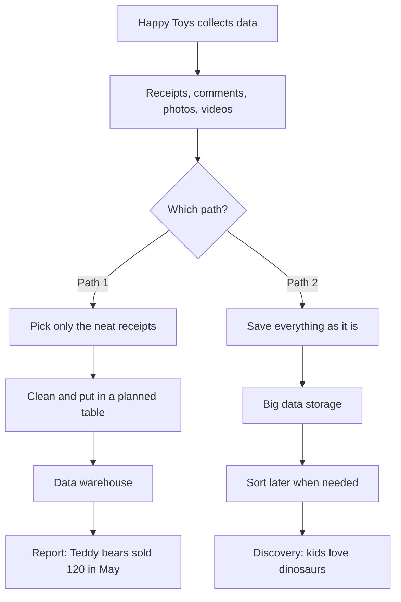

### Big Data
<html>

</html>

### 1.1 Definition
Big Data is an important part of today's digital world. It helps businesses understand customers, schools improve learning, scientists study animals, sports teams analyze performance, and social media platforms recommend content.
To understand how Big Data works, we will start with the 5Vs, which describe its main characteristics. Then, we will connect those ideas to five foundations: the definition of Big Data, data types and sources, data warehousing, Big Data technologies, and data processing and analytics.
### 1.2 Definition
Below is listed the table of 5V's

| Name of 5V's | Description | Examples |
|:---|:---|:---:|
| Volume | The amount of data collected and stored | Thousands of different types of students attending a school|
| Velocity | How quickly data is created, received, and processed | A news anchor receiving current, live information from an incident|
| Variety | The different types and formats of data, such as text, images, videos, and numbers | Pictures, Videos, Text messages, Call logs |
| Veracity | How accurate and reliable the data is | A teacher checks for duplicate survey responses to make sure the results are accurate |
| Value | The useful information or benefits gained from analyzing the data | A school uses students’ food preferences to decide what snacks to provide at a school event. 

https://www.techtarget.com/data-technologies/definition/5Vs-of-big-data
### 1.2 Definition
1. Evolution of Big Data
    - Traditional databases: People stored organized information, such as customer names and sales records. 
    - Web and social media: Websites and social media created more data, such as comments, photos, videos, and searches. 
    - Cloud computing: People could store data and use computer power over the internet.
    - Internet of Things (IoT): Devices such as smartwatches and sensors started collecting data automatically.
    - Today: Big Data tools and AI help people analyze large amounts of information.
    
2. Benefits of Big Data

| Benefits | Descriptions | Examples |
|:---|:---|:---:|
| Better Decisions | Big Data helps people make better choices by looking at information and finding patterns | A delivery company uses traffic data to find faster routes |
| Efficiency | Big Data helps people save time, money, and resources | A delivery company uses traffic data to find faster routes |
| Personalisation | Big Data helps apps and websites recommend things based on people's interests | YouTube recommends videos based on what you watch | 

3. Small Data

**Small data** is data with a volume and format that makes it accessible, informative and actionable for people. It is often described as data small enough for human comprehension: even five related pieces of data, or one eyewitness observation, can count.

The term is often explained as a contrast: **big data is about machines, small data is about people.**

Key Characteristics

| Characteristic | Explanation |
|---|---|
| **Small volume** | Can be read and understood without heavy processing tools |
| **Accessible** | Easy to collect, store and share |
| **Actionable** | Leads directly to a decision or a task |
| **Context-rich** | Explains the *why* behind behavior |
| **Often qualitative** | Includes observations, habits, preferences |

So, what's the difference between these two data types?

| Aspect | Small Data | Big Data |
|---|---|---|
| **Focus** | People | Machines |
| **Main goal** | Finding causation (the *why*) | Finding correlations (the *what*) |
| **Volume** | Small, human-readable | Enormous, needs special tools |
| **Insight type** | Qualitative, emotional | Quantitative, predictive |
| **Example** | Watching how a family uses its kitchen | Analyzing millions of online searches |

> They work best together: big data shows *what* is happening, small data helps explain *why*.

4. Why Small Data Matters

- Faster and cheaper to collect and analyze than big data.
- Gives context and emotion that large datasets often miss.
- Useful for small teams and businesses without big-data infrastructure.
- Started in marketing, now used across many industries.

---

### 1.3 Types of Data Structure

Small data can come in any of three structures.

1. Structured Data

Data organized in a predefined format with a fixed schema, usually rows and columns.

- **Easiest to analyze** of the three types.
- Works with traditional databases (SQL) and spreadsheets.
- **Examples:** sales figures, names and addresses, SKU numbers, prices, dates, phone numbers.

```sql
SELECT name, age, city FROM customers WHERE id = 101;
```

| id | name | age | city |
|---|---|---|---|
| 101 | Alexa | 32 | New York |
| 102 | Sam | 40 | Los Angeles |

2. Semi-Structured Data

Data that has some organization, such as tags or markers, but no rigid schema. It sits between structured and unstructured data and is often called *self-describing*.

- Easier to work with than unstructured data.
- Less useful than structured data, and can be hard to tag and index.
- **Examples:** JSON, XML, CSV files, NoSQL records, email metadata.

```json
{
  "name": "John",
  "age": 25,
  "city": "Chicago"
}
```

```xml
<Person>
  <Name>John</Name>
  <Age>25</Age>
</Person>
```

3. Unstructured Data

Data with no predefined format or model. It usually needs preprocessing or specialized tools before analysis.

- Can be generated by humans or machines.
- Keeps its original detail, but is hard to manipulate without the right tools.
- **Examples:** text documents, email bodies, images, audio, video, social media posts.

| Criteria | Structured | Semi-structured | Unstructured |
|---|---|---|---|
| **Schema** | Fixed | Flexible | None |
| **Format** | Tables | JSON, XML, CSV | Free form |
| **Ease of analysis** | Easy | Moderate | Hard |
| **Storage** | Relational DB | NoSQL / files | Data lakes / file storage |
| **Example** | Sales table | API response | Customer photo |

---

4. Sources of Small Data

> Mapping below is our team's own classification based on the definitions above.

| Source | Typical Structure | What It Looks Like |
|---|---|---|
| **Transactions** | Structured | One customer's purchase history |
| **IoT sensors** | Structured / Semi-structured | Temperature, wind speed, vibration, status readings |
| **Logs** | Semi-structured | App or server logs in JSON format |
| **Surveys / forms** | Structured | Feedback form answers |
| **Emails / messages** | Semi-structured / Unstructured | Customer complaints |
| **Observations / interviews** | Unstructured | Notes on how people use a product |

---

## Sources

- [Educative: Structured vs. semi-structured vs. unstructured data](https://www.educative.io/answers/structured-vs-semi-structured-vs-unstructured-data)
- [Big Data Framework: Data Types](https://www.bigdataframework.org/data-types-structured-vs-unstructured-data/)
- [CareerFoundry: Structured vs. Unstructured Data](https://careerfoundry.com/en/blog/data-analytics/structured-vs-unstructured-data/)
- [Datamation: Semi-Structured Data](https://www.datamation.com/big-data/semi-structured-data/)
- [World Economic Forum: Is small data the new big data?](https://www.weforum.org/stories/2016/04/is-small-data-the-new-big-data/)
- [Iberdrola: What is small data?](https://iberdrola.com/innovation/what-is-small-data)
- [Wikipedia: Small data](https://en.wikipedia.org/wiki/Small_data)

### 1.5 Big Data vs Data Warehousing

> **Section:** Big Data  
> **Chapter:** Introduction to Big Data  
> **Audience:** Elementary students with no prior knowledge of big data

---

## Explanations

### 📚 What is a data warehouse?

A **data warehouse** is a big storage place for information that has already been cleaned and organized into neat tables. Before data goes in, people decide where each piece belongs.

It is often used for clear reports that help people make decisions, like:

> "How many toys did we sell this month?"

### 📦 What is big data storage?

**Big data storage** can hold huge amounts of data of many kinds: tables, photos, videos, messages and sensor readings. The data goes in **as it is**, even if it is messy. People organize it **later**, when they need to use it.

### 🤝 Why do we need both?

- A warehouse is great when you already know what question you want to answer, and its data is clean and trustworthy.
- Big data storage is great when you have lots of different data and want to explore it and find patterns.
- Many organizations use both together.

---

## Terminology

| Term | Simple meaning |
|---|---|
| **Data warehouse** | A storage place for cleaned, organized data, used for reports |
| **Schema** | A plan for how data will be organized, like deciding which columns a table will have |
| **Raw data** | Data kept exactly as it was collected, before anyone cleans or sorts it |
| **Report** | A clear summary of data, like a chart showing monthly sales |
| **Big data storage** | A place that can keep huge amounts of data of any kind. One common type is called a *data lake* |
| **Data scientist** | A person who studies data to find useful patterns |

---

## Worked Example: Happy Toys Store

Happy Toys collects four kinds of data:

- [x] Sales receipts
- [x] Customer comments
- [x] Photos of the shelves
- [x] Videos from a store camera

### Path 1: The data warehouse

1. Take only the neat data: the **sales receipts**.
2. Clean it by fixing mistakes, like a toy name spelled two different ways.
3. Put it into a planned table with columns: `Date`, `Toy`, `Number sold`.
4. Make a report.

**Result:** "Teddy bears sold 120 in May."

### Path 2: Big data storage

1. Save **everything as it is**: receipts, comments, photos and videos.
2. Later, a data scientist sorts through the comments.
3. They notice many kids mention "dinosaurs" and see that dinosaur toys sell out fast.

**Result:** The store decides to order more dinosaur toys *before* they sell out.

### Flow diagram



> **What this shows:** The warehouse answered a question the store already knew to ask. Big data storage helped the store **discover something new**.

---

## Visual: Side-by-Side Comparison

| | **Data Warehouse** 📚 | **Big Data Storage** 📦 |
|---|---|---|
| **Data structure** | Neat, planned tables | Any kind: tables, photos, videos, messages |
| **How data is stored** | Cleaned and organized *before* storing, like books on labeled library shelves | Stored raw first, organized *later*, like boxes in a giant storage room |
| **Typical use** | Clear reports for business decisions | Exploring huge, varied data to find patterns |
| **Example question** | "How many toys did we sell in May?" | "What do kids seem to like that we haven't noticed yet?" |

---

## References

1. Splunk. *Data Lake vs. Data Warehouse: Definitions, Key Differences, and How to Integrate Data Storage Solutions.* https://splunk.com/en_us/blog/learn/data-warehouse-vs-data-lake.html
2. BMC Software. *Data Lake vs. Data Warehouse vs. Database: Key Differences Explained.* https://www.bmc.com/blogs/data-lake-vs-data-warehouse-vs-database-whats-the-difference/
3. TechTarget. *Data lake vs. data warehouse: Key differences explained.* https://www.techtarget.com/data-technologies/feature/Data-lake-vs-data-warehouse-Key-differences-explained
4. RudderStack. *Difference Between Big Data and Data Warehouses.* https://www.rudderstack.com/learn/data-warehouse/Difference-Between-Big-Data-And-Data-Warehouses/

> The Happy Toys example and the library and storage room comparisons are original illustrations, not taken from the references.

# Chapter 1: Introduction to Connectionist AI

## 1.1 Context and History

### 1.1.1 Early Neuron Models and the Perceptron

Connectionist AI originated from the idea that intelligent behavior could be modeled through networks of interconnected computational units inspired by biological neurons. In 1943, Warren McCulloch and Walter Pitts introduced a mathematical model of a simplified neuron, demonstrating how networks of these units could perform logical computations [1].

In 1949, Donald Hebb proposed that connections between neurons could strengthen through repeated activity, providing an influential theory of learning [2]. Later, in 1957–1958, Frank Rosenblatt developed the **perceptron**, an artificial neural network that could learn to classify certain patterns by adjusting its connection weights [3]. These developments established the foundations for trainable neural networks.

### 1.1.2 Setbacks

Despite early progress, neural networks faced significant limitations. Single-layer perceptrons could not solve certain problems, such as the **exclusive OR (XOR)** function, because these problems cannot be separated using a single linear decision boundary [4].

In 1969, Marvin Minsky and Seymour Papert published *Perceptrons*, which analyzed these limitations. Their work contributed to declining interest in some neural-network approaches, alongside practical difficulties such as limited computing power and the lack of effective methods for training multilayer networks [4][5]. However, neural-network research continued during this period.

### 1.1.3 Revival of Backpropagation

Connectionist AI regained momentum during the 1980s through renewed interest in neural-network models and parallel distributed processing. A major milestone was the 1986 paper by David Rumelhart, Geoffrey Hinton, and Ronald Williams, which demonstrated how **backpropagation** could train multilayer neural networks to learn useful internal representations [5].

Backpropagation calculates how the network's prediction error changes with respect to its parameters. Combined with optimization methods such as gradient descent, it allows the network to adjust its weights during training. This made multilayer networks more practical and helped overcome some limitations of single-layer perceptrons [5][6].

### 1.1.4 Deep Learning Boom

The development of deep learning accelerated as computing power increased, larger datasets became available, and neural-network training methods improved. Deep learning uses neural networks with multiple layers to learn increasingly complex representations from data [6].

A major milestone occurred in 2012, when Alex Krizhevsky, Ilya Sutskever, and Geoffrey Hinton introduced **AlexNet**, a deep convolutional neural network that achieved a substantial improvement in image classification in the ImageNet competition [7]. This result helped establish deep learning as a powerful approach to practical AI.

Since then, connectionist methods have expanded into computer vision, natural language processing, speech recognition, generative AI, and scientific research. Their ability to learn complex patterns from large datasets also makes them important in Big Data applications. However, their performance depends on data quality, suitable training methods, and sufficient computational resources [6][7].

### References

[1] McCulloch, W. S., & Pitts, W. (1943). *A logical calculus of the ideas immanent in nervous activity*. The Bulletin of Mathematical Biophysics, 5, 115–133.  
https://doi.org/10.1007/BF02478259

[2] Hebb, D. O. (1949). *The Organization of Behavior: A Neuropsychological Theory*. Wiley.

[3] Rosenblatt, F. (1958). *The perceptron: A probabilistic model for information storage and organization in the brain*. Psychological Review, 65(6), 386–408.  
https://doi.org/10.1037/h0042519

[4] Minsky, M., & Papert, S. (1969). *Perceptrons: An Introduction to Computational Geometry*. MIT Press.  
https://mitpress.mit.edu/9780262130431/perceptrons/

[5] Rumelhart, D. E., Hinton, G. E., & Williams, R. J. (1986). *Learning representations by back-propagating errors*. Nature, 323, 533–536.  
https://doi.org/10.1038/323533a0

[6] Goodfellow, I., Bengio, Y., & Courville, A. (2016). *Deep Learning*. MIT Press.  
https://www.deeplearningbook.org/contents/intro.html

[7] Krizhevsky, A., Sutskever, I., & Hinton, G. E. (2012). *ImageNet classification with deep convolutional neural networks*. Advances in Neural Information Processing Systems, 25.  
https://proceedings.neurips.cc/paper/2012/hash/c399862d3b9d6b76c8436e924a68c45b-Abstract.html
